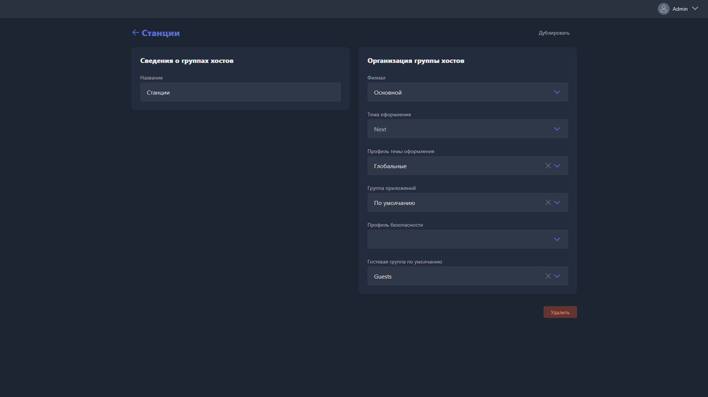
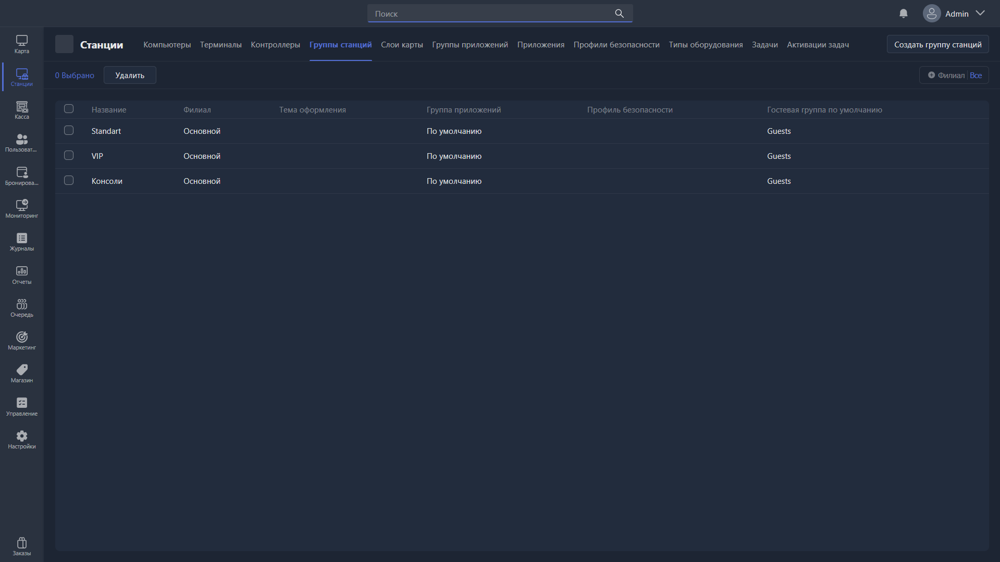
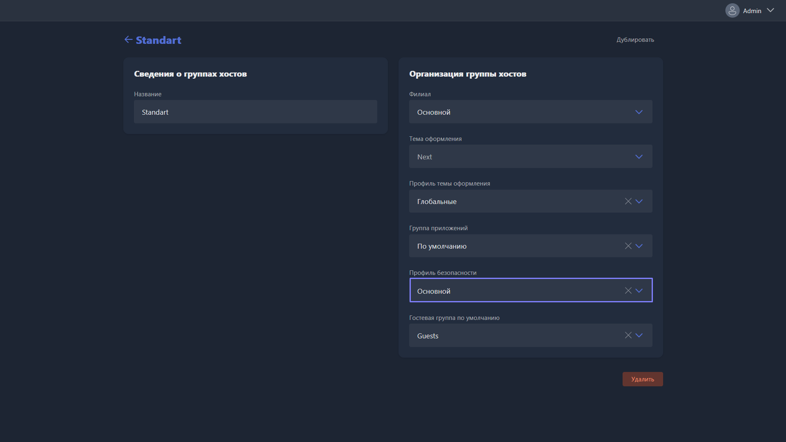

<html>

  

  

    

      <svg xmlns="http://www.w3.org/2000/svg" width="24" height="24" viewBox="0 0 24 24" fill="none" stroke="currentColor" stroke-width="2" stroke-linecap="round" stroke-linejoin="round"><rect x="5" y="11" width="14" height="10" rx="2"/><path d="M8 11V7a4 4 0 0 1 8 0v4"/></svg>
      В этом блоке вы узнаете
    

    <h2 class="gx-title">Как настроить профиль безопасности станций</h2>
    

      15–20 минут
      /
      Средняя сложность
    

  

</html>

Без профиля безопасности гость может делать с игровым пк что угодно, вплоть до отключения самой оболочки -- это стандартные возможности Windows, и заблокировать их можно только ограничив доступ к соответствующим настройкам системы. Профиль безопасности -- набор таких ограничений, который назначается группе станций целиком.

## Шаг 1. Настройте группы станций под игровые зоны

Игровые зоны -- это залы вашего клуба, которые отличаются ценами, оформлением и другими параметрами. Например, Standart, VIP и PS5 -- это три игровые зоны. Прежде чем настраивать профиль безопасности, определитесь с зонами -- профиль назначается именно на группу станций.

1. Перейдите в <cmd text="Станции"/> -> <cmd text="Группы станций"/>. По умолчанию там уже есть несколько групп -- их можно переименовать, удалить или создать свои.
2. Открыв группу, укажите филиал, профиль оформления, группу приложений и гостевую группу по умолчанию.

{width=1919px height=1079px}

3. Создайте группу под каждую игровую зону клуба -- например, для зон Standart, VIP и Консоли получится три группы станций.

{width=1919px height=1079px}

## Шаг 2. Создайте профиль безопасности

Откройте <cmd text="Станции"/> -> <cmd text="Профили безопасности"/> и создайте профиль. Параметры можно включать по своему усмотрению, но вот что мы рекомендуем большинству клубов.

1. **Общие ограничения оболочки**:
   - назовите профиль;
   - включите **Скрыть меню «Пуск»**, **Запретить сворачивать оболочку** и **Ограничение переключения между рабочими столами**.
2. **Файловая система**: в разделе **Файловая система** отметьте все буквы дисков -- так разделы будут скрыты и заблокированы для гостя.
3. **Политики**: в разделе **Политики** включите все параметры безопасности одной кнопкой.

Это максимальный уровень блокировки -- он закрывает гостю почти всё за пределами оболочки. Через профили можно также блокировать конкретные приложения, процессы и даже сайты в браузере гостя.

{width=1919px height=1079px}

## Шаг 3. Назначьте профиль группам станций

Профиль безопасности не применяется сам по себе -- его нужно привязать к группе станций.

1. Перейдите в <cmd text="Станции"/> -> <cmd text="Группы станций"/>.
2. Откройте каждую группу и привяжите к ней профиль безопасности.

> [!TIP]
> 
> Ограничения не безвозвратны -- их всегда можно снять, отключив безопасность на пк или переведя его в режим администратора.

## Шаг 4. При необходимости настройте разные профили до и после входа гостя

Профиль безопасности можно назначить в двух местах, и срабатывают они в разные моменты:

- **профиль группы станций** -- действует сразу после загрузки пк, в том числе на экране входа, когда за пк ещё никто не сидит;
- **профиль группы пользователей** (поле **Переопределение профиля безопасности** в карточке группы) -- включается, когда гость входит в систему, и на время его сеанса **заменяет** профиль группы станций.

Это позволяет сделать так: на экране входа пк закрыт максимально строгим профилем, а после входа гость получает более мягкий профиль -- например, с доступом к параметрам мыши и звука.

1. Создайте второй профиль безопасности с теми ограничениями, которые нужны гостю во время сеанса.
2. Откройте **Пользователи -> Группы пользователей**, выберите группу и включите **Переопределение профиля безопасности** с этим профилем. Подробнее -- в статье [«Карточка группы пользователей»](./../../usage/gizmo-manager/users/user-groups/user-group-card.md).

## Шаг 5. При необходимости заблокируйте отдельные программы

Если нужно запретить конкретную программу, в профиле безопасности, в разделе **Ограничения**, нажмите **+ Создать ограничение** и выберите **Тип ограничения**:

- **Имя файла** -- самый простой вариант: укажите имя исполняемого файла, например `chrome.exe`. Но его легко обойти, переименовав файл.
- **Название класса** -- надёжнее: гость не может изменить класс окна. Учтите, что один и тот же класс бывает у нескольких программ. Класс окна можно узнать бесплатной утилитой [WinLister](https://www.nirsoft.net/utils/winlister.html).
- **Название окна** -- заголовок окна, как он виден на панели задач (в WinLister -- столбец **Title**). Некоторые программы меняют заголовок на лету -- используйте подстановочные символы `*` и `?`.

Готовые ограничения для частых случаев:

| Что заблокировать | Тип ограничения | Параметр |
|---|---|---|
| Сетевое окружение | Название окна | `Network` |
| Параметры Windows | Имя файла | `SystemSettingsBroker.exe` |
| «Управление компьютером», «Управление дисками» и другие оснастки MMC | Название класса | `MMCMainFrame` |
| Microsoft Store | Имя файла | `WinStore.App.exe` |
| Все версии Cheat Engine | Название окна | `Cheat Engine*` |

Панель управления, контекстное меню панели задач и многое другое закрываются готовыми политиками -- их список в статье [«Карточка профиля безопасности»](./../../usage/gizmo-manager/stations/profili-bezopasnosti/kartochka-redaktirovaniya-profilya-bezopasnosti.md). Как скрыть панель задач целиком -- в статье [«Полезные скрипты для задач»](./../../articles/useful-task-scripts.md).

## Результат

На всех пк группы станций действуют ограничения профиля безопасности: гость не может открыть меню «Пуск», свернуть оболочку, переключиться на другой рабочий стол; диски скрыты и заблокированы, а доступ к настройкам системы ограничен политиками безопасности. Отключить оболочку гость больше не сможет.

Что ещё помогает держать клиентские пк в рабочем состоянии -- программы отката изменений, загрузка по сети, эталонный образ -- в статье [«Как защитить клиентские пк»](./../../articles/client-pc-protection.md).
