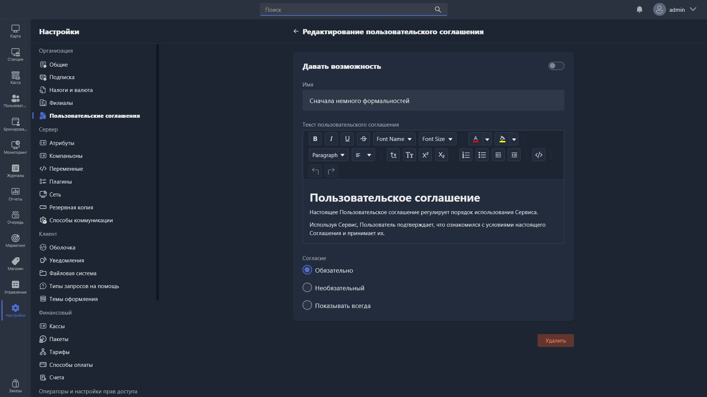

<html>

  

  

    

      <svg xmlns="http://www.w3.org/2000/svg" width="24" height="24" viewBox="0 0 24 24" fill="none" stroke="currentColor" stroke-width="2" stroke-linecap="round" stroke-linejoin="round"><path d="M6 22a2 2 0 0 1-2-2V4a2 2 0 0 1 2-2h8a2.4 2.4 0 0 1 1.704.706l3.588 3.588A2.4 2.4 0 0 1 20 8v12a2 2 0 0 1-2 2z"/><path d="M14 2v5a1 1 0 0 0 1 1h5"/></svg>
      В этом блоке вы узнаете
    

    <h2 class="gx-title">
      Как настроить пользовательское соглашение для ваших клиентов
    </h2>
    

      3–5 минут
      /
      Низкая сложность
    

    
Разберём, где включить соглашение, как оформить его текст и сделать обязательным для клиента при регистрации.

  

</html>

Пользовательское соглашение -- это условия, на которых клуб оказывает услуги: гость видит их в Gizmo Client при авторизации и, если соглашение обязательное, не получит доступ к оболочке, пока не подтвердит согласие. Соглашение подходит не только для юридических документов -- через него удобно показать гостю правила клуба.

Обычно клубы создают два соглашения и более -- например, «Правила клуба» и «Соглашение о конфиденциальности». Соглашения общие для всей организации: все активные соглашения показываются во всех филиалах.

## Шаг 1. Создайте соглашение

1. Откройте **Настройки -> Организация -> Пользовательские соглашения**.
2. Нажмите **Создать пользовательское соглашение** в правом углу страницы -- откроется карточка нового соглашения.

{width=1919px height=1079px}

## Шаг 2. Заполните название и текст

1. Укажите название соглашения -- например, «Правила клуба».
2. Введите текст соглашения. Текст поддерживает HTML-разметку: чтобы вставить готовый HTML-код, переключитесь в режим просмотра кода кнопкой <icon code="code-xml" />.

> [!TIP]
>
> HTML позволяет оформить соглашение как полноценную веб-страницу -- с форматированием и в стиле клуба. Отформатировать текст можно в любом онлайн-редакторе, например [editorhtmlonline.com](https://editorhtmlonline.com/ru/), а затем вставить получившийся HTML-код в поле текста соглашения.

## Шаг 3. Выберите правило отображения

В пункте **Согласие** выберите, как соглашение будет показываться гостю в Gizmo Client:

- **Обязательно** -- соглашение показывается при авторизации, и гость не получит доступ к функциям Gizmo Client, пока не подтвердит согласие. При следующих авторизациях больше не показывается.
- **Опционально** -- соглашение показывается при авторизации, но гость может пропустить ознакомление и сразу получить доступ к функциям Gizmo Client. При следующих авторизациях больше не показывается.
- **Всегда показывать** -- соглашение показывается при каждой авторизации гостя.

## Шаг 4. Включите соглашение и сохраните

1. Проверьте, что тумблер **Статус** в карточке включён -- иначе соглашение не будет показываться в Gizmo Client.
2. Сохраните карточку.

Если соглашений несколько, задайте порядок их показа: в таблице на странице **Пользовательские соглашения** перетащите строку за значок перетаскивания <icon code="grip-vertical" /> слева. Там же столбцом **Включить** можно быстро включить или выключить показ соглашения, а двойным кликом по строке -- открыть его карточку.

> [!NOTE]
>
> Чтобы удалить соглашение, откройте его карточку и нажмите **Удалить** в правом нижнем углу.

## Результат

- При авторизации в Gizmo Client гость видит все включённые соглашения в заданном порядке.
- Обязательное соглашение нужно принять, чтобы начать пользоваться оболочкой; опциональное можно пропустить; соглашение с правилом **Всегда показывать** появляется при каждой авторизации.

Описание всех полей -- в статьях [«Пользовательское соглашение»](./../../configure/organization/user-agreements/_index.md) и [«Карточка пользовательского соглашения»](./../../configure/organization/user-agreements/user-agreement-card.md) раздела «Настройка».
