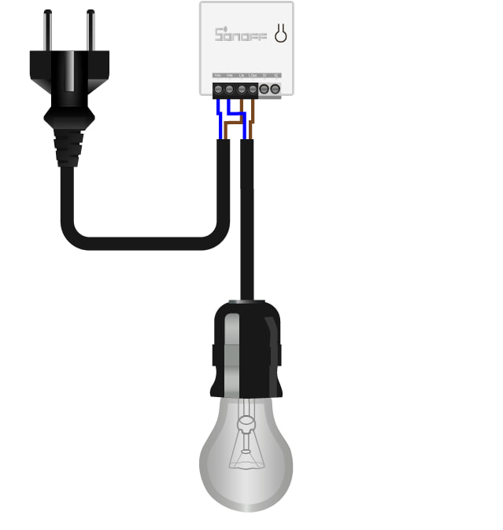
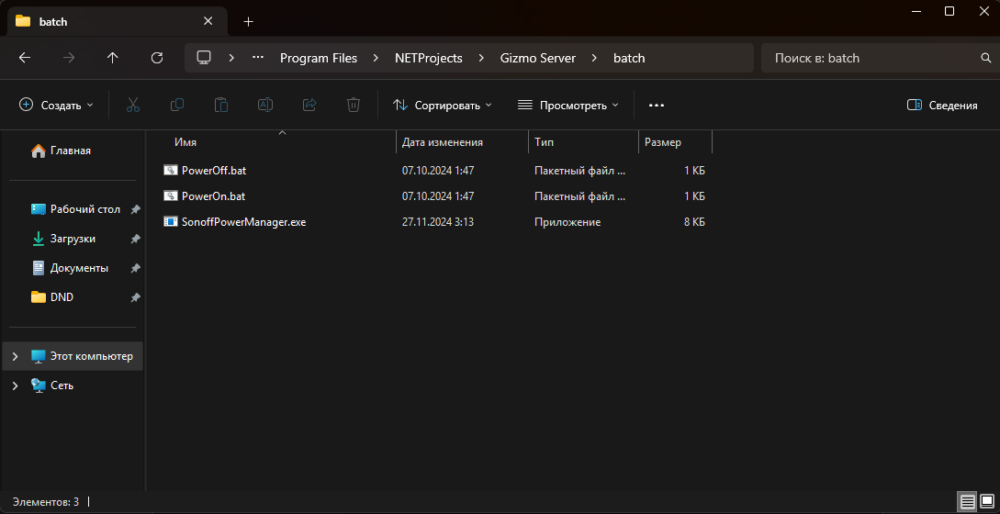
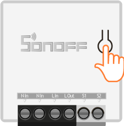
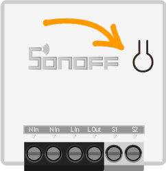
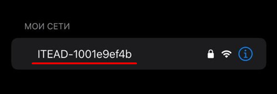
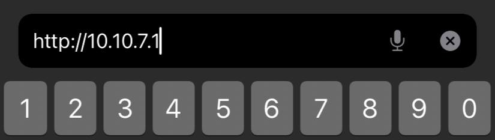
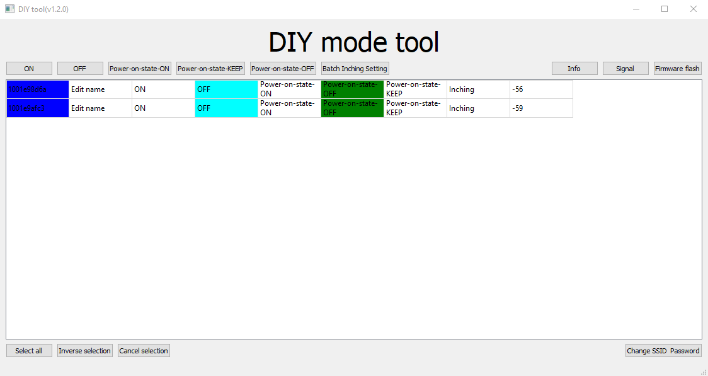

Экран или питание консольного места можно включать и выключать прямо из Gizmo Manager -- через умное реле или розетку с управлением по сети. Гостю не нужно ждать администратора, а администратору -- подходить к месту.

Для этого Gizmo Server запускает серверные скрипты, а скрипты отправляют команду устройству. В инструкции -- как это работает и как настроить три вида устройств: реле **Sonoff**, контроллеры на прошивке **Tasmota** (например, Enestech) и розетки **EnerGenie**.

> [!TIP]
>
> Если нужно управлять HDMI-сигналом, светодиодной лентой и командами CEC, используйте [Gizmo HDMI Controller](./../../articles/gizmo-hdmi-controller.md) -- он подключается к Gizmo без скриптов.

## Как работают скрипты питания

В папке `batch` сервера лежат скрипты, которые Gizmo Server запускает при действиях с игровыми местами:

- `PowerOn.bat` -- при нажатии **Включить** у места в Gizmo Manager;
- `PowerOff.bat` -- при нажатии **Выключить**.

Gizmo передаёт в скрипт номер места -- в скрипте он доступен как `%1`. По этому номеру скрипт определяет, каким устройством управлять.

Папка на Windows по умолчанию -- `C:\Program Files\NETProjects\Gizmo Server\batch`. На Linux и в Docker вместо `.bat` используются файлы `.sh`.

> [!IMPORTANT]
>
> Номера в скриптах должны совпадать с номерами мест (терминалов) в Gizmo -- иначе команда уйдёт не тому устройству. Как добавить консольное место -- в инструкции [«Как добавить консоль или другое игровое место»](./add-terminal.md).

Сервер должен постоянно видеть устройства по сети. Если устройства в другой подсети, настройте маршрутизацию на роутере и разрешите трафик в брандмауэре.

## Реле Sonoff

Подойдёт любое реле Sonoff с поддержкой режима **DIY** -- список есть в [документации Sonoff](https://help.sonoff.tech/docs/puU2rU4w). Схема подключения реле в разрыв питания:

{width=639px height=674px}

### Шаг 1. Подготовьте утилиты на сервере

1. Скачайте архив с утилитами: **[ССЫЛКА: архив утилит Sonoff]**.
2. Скопируйте `PowerOn.bat`, `PowerOff.bat` и `SonoffPowerManager.exe` в папку `batch` сервера. Если там уже есть файлы с такими именами, замените их.
3. Утилиту `tool_01DIY85(3.3.0).exe` положите в любое удобное место на сервере.

{width=1089px height=560px}

### Шаг 2. Переведите реле в режим DIY

> [!IMPORTANT]
>
> Если реле раньше было подключено к приложению eWeLink, сначала удалите его из списка устройств в приложении.

1. Включите питание реле.
2. Удерживайте кнопку сопряжения дольше 5 секунд.

   {width=246px height=250px}

3. Индикатор начнёт непрерывно мигать -- реле в режиме сопряжения.

   {width=242px height=250px}

4. На телефоне или пк откройте список сетей Wi-Fi и подключитесь к точке доступа **ITEAD-XXXXXXXXXX** с паролем `12345678`.

   {width=455px height=155px}

5. Откройте в браузере адрес `http://10.10.7.1`. Если страница не открывается, реле уже подключалось к Wi-Fi или к eWeLink -- сбросьте его до заводских настроек (см. ниже) и повторите шаги.

   {width=825px height=233px}

6. На открывшейся странице укажите **SSID** (имя сети Wi-Fi клуба) и пароль сети, к которой должно подключиться реле.

### Шаг 3. Узнайте deviceid реле

1. На сервере запустите `tool_01DIY85(3.3.0).exe` и дождитесь, пока реле появится в списке устройств.
2. Перепишите **deviceid** -- он в первой колонке, выделенной синим.
3. Проверьте реле кнопками **ON** и **OFF**: если экран консоли включается и выключается, всё настроено правильно.

{width=1124px height=597px}

Если реле нет в списке, проверьте, что сервер и реле в одной сети, и повторите шаг 2. IP-адрес реле можно узнать в настройках роутера.

### Шаг 4. Настройте скрипты

Откройте `PowerOn.bat` в текстовом редакторе -- правой кнопкой мыши -> **Изменить**. Не открывайте файл двойным нажатием: так скрипт просто запустится.

```
@echo off
set WORKING_DIRECTORY="%~dp0
set host1=192.168.63.101:8081
set deviceid1=1001ee63f1
@echo off
if %1==101 set host=%host1% & set deviceid=%deviceid1%
%WORKING_DIRECTORY%SonoffPowerManager.exe" %deviceid% %host% 1
```

Замените значения:

- `192.168.63.101:8081` -- IP-адрес и порт вашего реле;
- `1001ee63f1` -- deviceid реле из шага 3;
- `101` в строке `if %1==101` -- номер места (консоли) в Gizmo.

Скопируйте весь код в `PowerOff.bat` и замените `1` в конце последней строки на `0` -- это команда выключения.

**Если реле несколько**, добавьте для каждого свои `host` и `deviceid` и свою строку `if`:

```
@echo off
set WORKING_DIRECTORY="%~dp0
set host1=192.168.63.101:8081
set host2=192.168.63.102:8081
set deviceid1=1001ee63f1
set deviceid2=1001ee63f2
@echo off
if %1==101 set host=%host1% & set deviceid=%deviceid1%
if %1==102 set host=%host2% & set deviceid=%deviceid2%
%WORKING_DIRECTORY%SonoffPowerManager.exe" %deviceid% %host% 1
```

### Как сбросить реле до заводских настроек

1. Установите на телефон приложение **eWeLink**.
2. Удерживайте кнопку реле 5 секунд, чтобы включить режим совместимого сопряжения.
3. В приложении нажмите **Добавить** -> **Больше опций** -> **Совместимое сопряжение** -> **Далее**.
4. Введите SSID и пароль сети Wi-Fi и нажмите **Далее** -- реле добавится в приложение.
5. Удалите реле из приложения -- оно сбросится до заводских настроек.

## Контроллер на прошивке Tasmota (Enestech)

Контроллеры на чипе ESP8266, например Enestech, можно перепрошить на открытую прошивку Tasmota и управлять ими HTTP-командами.

### Шаг 1. Прошейте контроллер

1. Подключите контроллер к пк и установите [драйвер USB-UART](https://www.silabs.com/developers/usb-to-uart-bridge-vcp-drivers) для вашей Windows.
2. Скачайте утилиту [Tasmotizer](https://github.com/tasmota/tasmotizer/releases).
3. В Tasmotizer выберите COM-порт контроллера -- его номер виден в **Диспетчере устройств**.
4. Отметьте **Save original firmware** -- исходная прошивка сохранится в папке программы, и при неудаче к ней можно будет вернуться.
5. Нажмите **Tasmotize!** и дождитесь окончания прошивки.
6. Перезагрузите контроллер и проверьте, что он подключился к Wi-Fi клуба.

### Шаг 2. Настройте контроллер

1. Найдите IP-адрес контроллера -- в веб-интерфейсе роутера или сканером сети, например [Advanced IP Scanner](https://www.advanced-ip-scanner.com/).
2. Откройте этот адрес в браузере -- откроется веб-интерфейс Tasmota. Кнопка **Переключить** включает и выключает реле вручную.
3. Откройте **Конфигурация -> Template**, в списке **Based on** выберите **Generic (18)**.
4. Для вывода **GPIO14** выберите **Relay** -- на нём находится реле, которое управляет HDMI-сигналом. Сохраните.

### Шаг 3. Настройте скрипты

1. Положите в папку `batch` сервера утилиту `curl.exe`, если её там нет, -- скачать можно на [curl.se](https://curl.se/download.html).
2. Откройте `PowerOn.bat` в текстовом редакторе и впишите:

```
@echo off
set WORKING_DIRECTORY="%~dp0
set host1=192.168.2.161
if %1==20 set host=%host1%
%WORKING_DIRECTORY%curl.exe" "%host%/cm?cmnd=Power%%20On"
```

- `192.168.2.161` -- IP-адрес контроллера;
- `20` -- номер места в Gizmo.

Для нескольких контроллеров добавьте `host2`, `host3` и т. д. и по строке `if` на каждое место.

3. Скопируйте код в `PowerOff.bat` и замените в последней строке `On` на `Off`.

## Розетки EnerGenie

Поддерживаются сетевые розетки EnerGenie:

- [EG-PM2-LAN](https://energenie.com/item.aspx?id=7557) -- Ethernet;
- [EG-PMS2-LAN](https://energenie.com/item.aspx?id=7416) -- Ethernet, защита от скачков напряжения;
- [EG-PMS2-WLAN](https://energenie.com/item.aspx?id=7678) -- Wi-Fi, защита от скачков напряжения;
- [EG-PMS2-LANSW](https://energenie.com/item.aspx?id=7442) -- швейцарские розетки, Ethernet, защита от скачков напряжения.

Каждой розеткой устройства можно управлять отдельно -- например, включать питание телевизора, консоли или света.

1. Подключите EnerGenie к сети клуба.
2. Скачайте архив со скриптами -- **[ССЫЛКА: energenie.zip]** -- и распакуйте его в папку `batch` сервера.
3. Откройте `PowerOn.bat` в текстовом редакторе и сопоставьте места с розетками: например, консоль № 1 в Gizmo -- первая розетка EnerGenie, консоль № 2 -- вторая и т. д.
4. Повторите то же для `PowerOff.bat`.

## Проверьте работу

1. Откройте **Карту** в Gizmo Manager и выберите консольное место.
2. Нажмите **Включить** -- устройство должно включиться. Затем **Выключить**.

Если ничего не происходит, проверьте номер места в скрипте, IP-адрес устройства и то, что сервер видит устройство по сети. Как управлять питанием мест -- в инструкции [«Как удалённо включить, перезагрузить и выключить пк»](./power-management.md).
