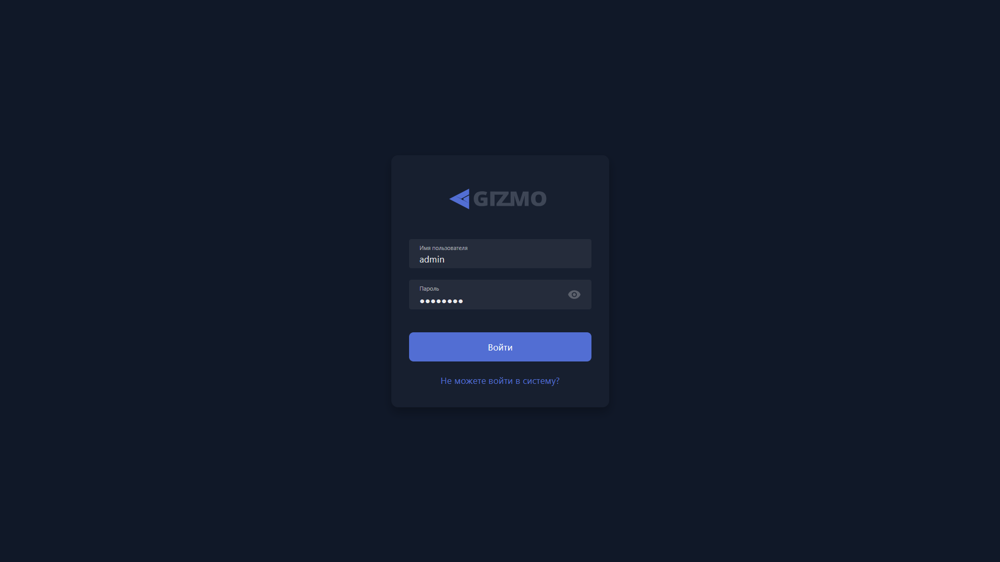
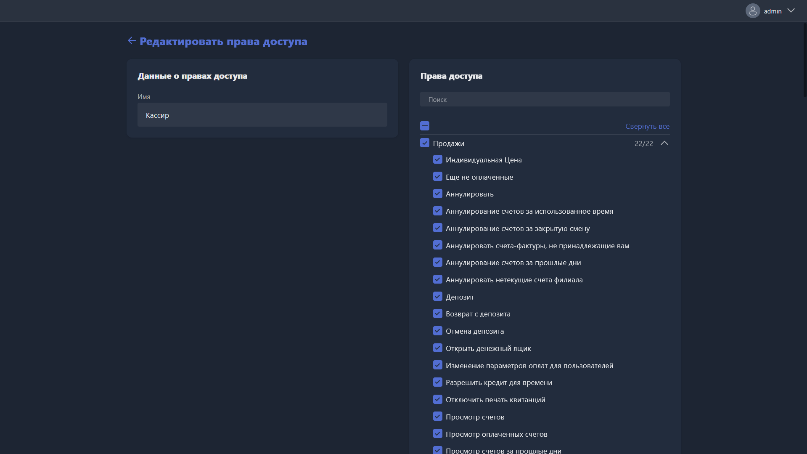
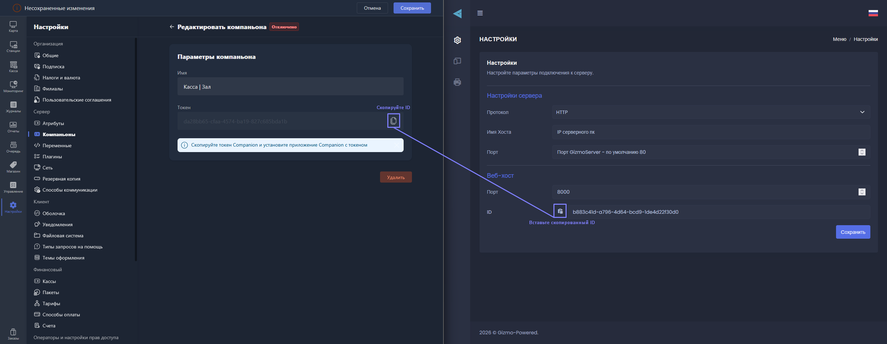
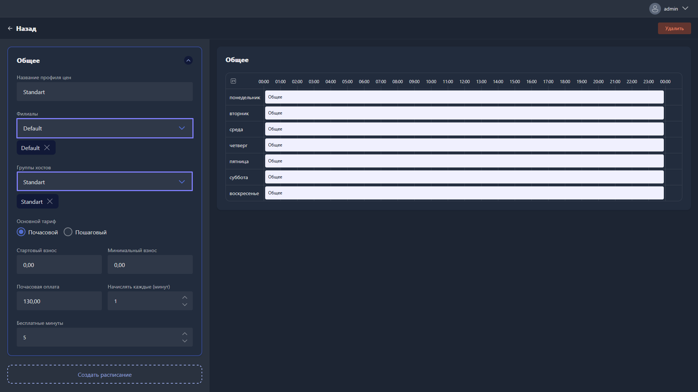
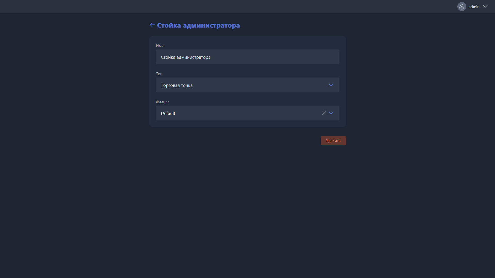
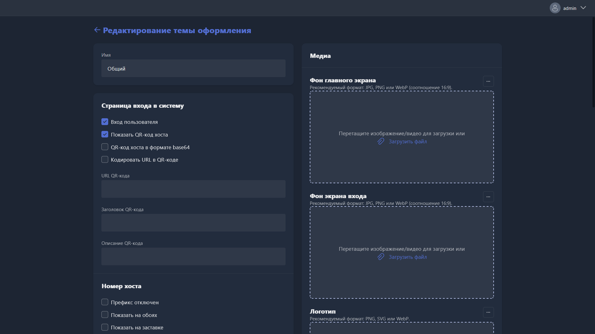
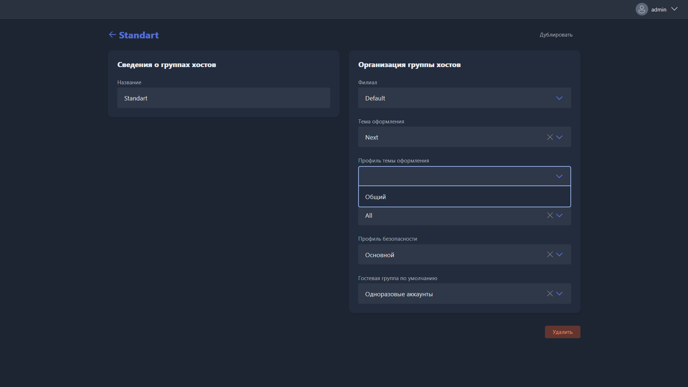
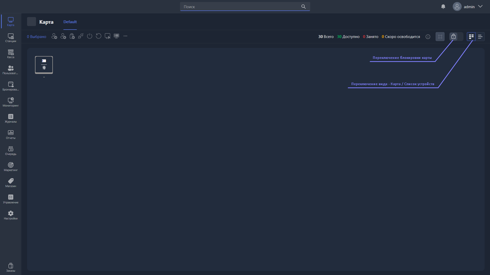

<html>

  

  

    

      <svg xmlns="http://www.w3.org/2000/svg" width="24" height="24" viewBox="0 0 24 24" fill="none" stroke="currentColor" stroke-width="2" stroke-linecap="round" stroke-linejoin="round"><path d="M6 22a2 2 0 0 1-2-2V4a2 2 0 0 1 2-2h8a2.4 2.4 0 0 1 1.704.706l3.588 3.588A2.4 2.4 0 0 1 20 8v12a2 2 0 0 1-2 2z"/><path d="M14 2v5a1 1 0 0 0 1 1h5"/></svg>
      В этом блоке вы узнаете
    

    <h2 class="gx-title">
      Как обновить ваш клуб на Gizmo V3
    </h2>
    

      30–50 минут
      /
      Высокая сложность
    

  

</html>

> [!NOTE]
>
> <color color="#fc7b03">**Руководство сложное, и на некоторых этапах могут возникнуть трудности. Если появятся вопросы, [обратитесь в поддержку](./../about/support.md) -- или доверьте обновление нам: оставьте заявку, и мы бесплатно переведём ваш клуб на V3.**</color>

<color color="#99B1E6">**Новая версия кардинально отличается от предыдущей -- менеджер переехал в браузер, появилась работа с несколькими филиалами в одном пространстве, полностью поменялась система лояльности, и многое, многое другое. Чтобы вы могли быстро и без потерь перейти на V3, мы подготовили пошаговую инструкцию.**</color>

Руководство разделено на три части -- проходите их по порядку:

1. **Установка Gizmo Server V3** -- от подготовки до первого входа в Gizmo Manager.
2. **Настройка после обновления** -- всё, что не переносится из V2 автоматически или работает по-новому. После этой части клуб готов к работе.
3. **Дальнейшая настройка** -- новые возможности V3, оформление и полезные статьи для знакомства с системой.

## Часть 1. Установка Gizmo Server V3

### 1\.1 Подготовка

> [!WARNING]
>
> Перед установкой убедитесь, что всё готово к миграции.

- **Резервная копия базы данных V2** -- **обязательно** сделайте её перед началом: если что-то пойдёт не так, копия позволит вернуть клуб в исходное состояние. Если не знаете, как сделать копию в V2, [обратитесь в поддержку](./../about/support.md) до начала обновления.
- **Сервер соответствует системным требованиям** -- для Windows это процессор Intel Core i3 8-го поколения или лучше, 16 ГБ DDR4 и 40 ГБ SSD NVMe. Требования для других вариантов установки -- в статье [«Быстрый старт»](./../instalation/quick-install.md).
- **База данных** -- Gizmo Server работает с Microsoft SQL или PostgreSQL. Подробнее о поддерживаемых СУБД -- в статье [«Базы данных»](./../instalation/gizmo/self-hosted/databases/_index.md).
- **Аккаунт на [сайте Gizmo](https://gizmopowered.ru/)** -- через него активируется лицензия и приходят обновления.
- **Время** -- обновление занимает 30–50 минут. Всё это время клуб не сможет нормально работать, поэтому выберите нерабочие часы.

### 1\.2 Загрузка и установка

1. [Загрузите установщик Gizmo Server V3](https://gizmopowered.net/downloads/v3/latest/GizmoServiceSetup.exe) на пк, где сейчас работает сервер V2.
2. Запустите установщик и пройдите все этапы, нажимая **Далее**. Рекомендуем **не менять** путь установки по умолчанию.
3. Старую версию удалять не нужно -- достаточно пройти все шаги установщика.

### 1\.3 Запуск сервера

Сервер можно запустить двумя способами -- подробно они описаны в статье [«Режимы работы сервера»](./../usage/gizmo-server/run-modes.md).

- **Как службу (рекомендуем)** -- сервер будет работать в фоне и запускаться вместе с системой. Откройте приложение **ConfigurationTool** по пути `C:\Program Files\NETProjects\Gizmo Server\tools\configuration`, перейдите в раздел **«Управление Сервисом Gizmo»**, установите службу и запустите её.
- **Как консольное приложение** -- через ярлык на рабочем столе. Сервер не будет запускаться автоматически при старте системы, поэтому этот режим подходит для разовых запусков и сбора ошибок.

> [!WARNING]
>
> При первом запуске может возникнуть ошибка -- чтобы исправить её, просто закройте приложение и откройте снова.

### 1\.4 Первый вход в Gizmo Manager

1. На пк с сервером откройте в браузере `https://gizmo.local/apps/manager/signin` -- по этому адресу вы будете заходить в Gizmo Manager. Если вам привычнее работать с десктопными приложениями, [установите менеджер как приложение](./gizmomanager-as-an-app.md).
2. Авторизуйтесь под учётной записью оператора -- подойдёт любой аккаунт, так как права доступа временно сброшены.

{width=1919px height=1079px}

3. Выберите филиал -- сейчас доступен только **Default**, он создаётся по умолчанию при обновлении.

> [!NOTE]
>
> Филиалы -- это новая функция разделения заведений, подключённых к одному серверу. Она позволяет сетям клубов объединить их в экосистему с общей базой пользователей, настройками, администраторами и другим функционалом. Подробнее -- в статье [«Филиалы»](./../configure/organization/branches/_index.md).

4. Выберите кассу, через которую работаете. Касса -- это пк, с которого администратор совершает продажи. Настроим кассы во второй части руководства, а подробнее о них -- в статье [«Кассы»](./../configure/finance/registers/_index.md).

**Готово -- вы на карте клуба, сервер V3 работает. Не спешите начинать работу и переходите ко второй части.**

## Часть 2. Настройка после обновления

Gizmo Manager полностью переработан: часть функций переехала, часть изменилась, а часть появилась впервые.

**Как ориентироваться в менеджере.** Слева -- панель навигации по разделам: «Карта», «Станции», «Касса», «Пользователи», «Маркетинг», «Магазин» и другие. Почти всё, что нужно в этой части, находится в разделе **Настройки** в самом низу панели. Назначение каждого раздела описано в статье [«Панель навигации»](./../usage/gizmo-manager/interface/navigation-panel.md), а общее устройство экрана -- в статье [«Интерфейс»](./../usage/gizmo-manager/interface/_index.md).

**Что обязательно настроить заново.** При обновлении не переносятся: права доступа операторов, правила подключения клиентских пк, опции клиентской оболочки и автоматический повторный вход гостя. Все они разобраны ниже -- пройдите пункты по порядку.

### 2\.1 Язык и данные организации

1. Перейдите в **Settings -> Organization -> General** -- пока язык не изменён, интерфейс отображается на английском.
2. В региональных настройках укажите **язык**, **часовой пояс** и **страну**. Часовой пояс важен: по нему записываются дата и время всех операций в базе данных, например транзакций.
3. Заполните информацию об организации: название компании, электронную почту и сайт.
4. Сохраните изменения и обновите страницу.

Подробнее о каждом поле -- в статье [«Общие»](./../configure/organization/general.md).

### 2\.2 Подписка

Откройте **Настройки -> Организация -> Подписка** и проверьте, что подписка активна, а лицензий не меньше, чем игровых мест в клубе, включая консоли. Если лицензий не хватает, часть пк не подключится к серверу. Подробнее -- в статье [«Подписка»](./../configure/organization/subscription.md).

### 2\.3 Филиал

1. Перейдите в **Настройки -> Организация -> Филиалы** и откройте филиал **Default**.
2. Укажите понятное название и адрес клуба, сохраните изменения. Все поля -- в статье [«Карточка филиала»](./../configure/organization/branches/branch.md).

Если у вас несколько клубов, их можно добавить как отдельные филиалы на этом же сервере -- см. [«Несколько клубов на одном сервере»](./operations/multiple-clubs-setup.md).

### 2\.4 Права доступа и операторы

Права теперь привязаны не к конкретному оператору, а к **набору прав доступа** -- набор достаточно создать один раз и указать его в профиле каждого оператора.

1. Перейдите в **Настройки -> Операторы и права доступа -> Права доступа**. Здесь уже есть готовые наборы -- их можно использовать или создать свои кнопкой **«Создать право доступа»**, указав название, например «Кассир», «Управляющий», «Руководитель». Узнать, что означает то или иное право, можно, наведя на него курсор, -- или в статье [«Карточка прав доступа»](./../configure/operators-and-permissions/permissions/permission-card.md). Чем отличаются готовые наборы -- в статье [«Как выбрать готовый набор прав доступа»](./staff/permission-presets.md).

{width=1919px height=1079px}

2. Перейдите в раздел **Операторы**. Для каждого оператора укажите **филиал**, к которому он привязан, и **предустановку прав доступа**. Все поля карточки -- в статье [«Карточка оператора»](./../configure/operators-and-permissions/operators/operators-card.md).
3. Выйдите из системы и авторизуйтесь заново -- новые права текущего оператора применятся только после повторного входа.

> [!WARNING]
>
> Для имён операторов появились ограничения -- в них нельзя использовать пробелы, а длина должна составлять не менее 5 символов.

### 2\.5 Сеть и подключение клиентских пк

Без правил подключения клиентские пк не подключатся к серверу автоматически.

1. Откройте **Настройки -> Сервер -> Сеть**.
2. В поле **Имя хоста** укажите локальный IP или DNS-имя сервера, либо `gizmo.local`, если не знаете, что вписывать. Имя хоста обязательно для [удалённого доступа](./../usage/gizmo-manager/map/remote-access.md) и [удалённого управления](./../usage/gizmo-manager/management/_index.md) клиентскими пк. Как узнать локальный IP сервера -- в статье [«Доступ к Gizmo по сети»](./client-shell/network-access.md).
3. В блоке **Правила подключения** включите все пункты.
4. Сохраните изменения.

> [!NOTE]
>
> `gizmo.local` автоматически определяет, какой IP у вашего сервера. Это может приводить к чуть более медленной загрузке удалённого доступа и некоторых других функций. Для максимальной скорости рекомендуем указать IP или DNS-имя вручную.

Подробный разбор всех параметров сети -- в статье [«Сеть»](./../configure/server/network.md).

### 2\.6 Gizmo Companion и кассы

Теперь поддерживается работа с несколькими **кассами** и **терминалами** в одном клубе. Для этого на каждую точку продаж (пк администратора) устанавливается небольшое приложение -- **Gizmo Companion**. Без него продажи не заработают.

**Подключите Companion к серверу**

1. В Gizmo Manager перейдите в **Настройки -> Сервер -> Компаньоны** и нажмите **«Создать Companion»**. Укажите имя, например расположение точки продаж.
2. Откройте созданный компаньон и скопируйте **токен**.
3. В **Настройки -> О программе** скачайте установщик Gizmo Companion -- см. [«О программе»](./../configure/others/about.md).
4. Установите его на пк, с которого будете совершать продажи, и откройте интерфейс Companion -- ярлыком на рабочем столе или по адресу [localhost:8000](http://localhost:8000) в браузере на этом же пк.
5. В полях **Протокол**, **Имя хоста** и **Порт** укажите данные для подключения к серверу: имя хоста -- IP сервера, порт по умолчанию -- 80.
6. Вставьте скопированный токен и сохраните изменения.
7. Вернитесь в **Настройки -> Сервер -> Компаньоны** и проверьте, что статус сменился на **«Подключено»**.

{width=2558px height=993px}

**Привяжите Companion к кассе**

1. Перейдите в **Настройки -> Финансовый -> Кассы**. Здесь вы увидите множество ранее созданных касс -- это имена всех пк, которые когда-либо подключались к серверу.

> [!TIP]
>
> Вы можете удалить все кассы и создать только нужные, чтобы очистить этот раздел.

2. Откройте кассу точки продаж и укажите **Филиал**, **Компаньон**, **Номер** и **Имя**.
3. Если точка продаж в клубе одна, включите **Касса по умолчанию для филиала**.
4. Сохраните изменения.

Все поля кассы -- в статье [«Карточка кассы»](./../configure/finance/registers/register-card.md), все параметры компаньонов -- в статье [«Компаньоны»](./../configure/server/companions/_index.md).

### 2\.7 ККТ, эквайринг и налоги

<color color="#99B1E6">**Только для клубов с подключённым к Gizmo ККТ или терминалом эквайринга.**</color>

1. Откройте **Настройки -> Финансовый -> Кассы**, выберите кассу, с которой будете работать, и укажите в её параметрах номер принтера фискальных чеков (ККТ) или терминала эквайринга -- нумерация указана в KKMServer.
2. Перейдите в **Настройки -> Организация -> Налоги и валюта**, укажите **Валюту по умолчанию** и заполните все поля в подразделе **Настройки налогов компании**. Будьте внимательны -- эти параметры используются при печати чеков. Подробнее -- в статье [«Налоги и валюта»](./../configure/organization/taxes-and-currency.md).
3. Сохраните изменения.

> [!NOTE]
>
> Если интеграция с ККМ-сервером ранее настраивалась нашими специалистами -- [**обратитесь в чат поддержки**](./../about/support.md), мы подскажем нужные данные для ввода.

**Готово -- ККТ и терминал связаны с Gizmo Companion, который, в свою очередь, привязан к кассе.**

### 2\.8 Тарифы

Раньше тариф (в прошлом -- профиль цен) создавался отдельно и мог быть привязан к группе пользователей или переопределён для групп хостов. Теперь тариф нужно привязать сразу к **филиалу** и [**группе станций**](./../usage/gizmo-manager/stations/station-groups/_index.md) (Standart, VIP и т. п.):

1. Перейдите в **Настройки -> Финансовый -> Тарифы**.
2. Дважды нажмите на тариф, который будет использоваться для группы (групп) станций.
3. Укажите **Филиал** и **группы станций**, на которых этот тариф будет действовать.
4. Сохраните изменения и повторите для остальных тарифов.

{width=1919px height=1079px}

> [!TIP]
>
> Вероятно, что в вашем клубе уже могли быть настроены тарифы для клиентов со скидками -- например, Standart 10%. Так как скидочная система была переработана, эти тарифы больше не нужны, их можно удалить. Новые скидки настроим ниже, в пункте 2.11 «Скидки».

Подробнее о тарифах и расписаниях -- в инструкции [«Тарификация»](./sales/pricing/tariffs-guide.md), все поля -- в статье [«Карточка тарифа»](./../configure/finance/tariffs/tariff-card.md).

### 2\.9 Склад

С поддержкой нескольких филиалов появилась возможность разделить склад между ними:

1. Перейдите в **Магазин -> Склады** и откройте склад **Default**, созданный по умолчанию.
2. Переименуйте его и укажите **Филиал**, к которому он будет привязан.
3. Сохраните изменения.
4. Откройте **Настройки -> Финансовый -> Кассы**, выберите кассу и привяжите к ней этот склад -- так продажи с неё будут списываться именно с него.

{width=1919px height=1079px}

> [!IMPORTANT]
>
> У склада доступны два типа -- **Торговая точка** и **Склад**. Тип не влияет на работу склада, это лишь визуальное удобство: торговая точка -- например, холодильник у стойки администратора, склад -- подсобка в клубе или полноценное складское помещение для крупных сетей клубов.

Пополнения, списания, переводы и инвентаризация -- в инструкции [«Склад»](./sales/shop/warehouse.md), описание раздела -- в статье [«Склады»](./../usage/gizmo-manager/magazin/warehouses.md).

### 2\.10 Клиентская оболочка

Опции оболочки -- скрытие разделов в клиенте, фоновое изображение и другие настройки из Gizmo Server Configuration Wizard -- переехали в менеджер, и их нужно указать заново.

1. Перейдите в **Настройки -> Клиент -> Темы оформления** и создайте новый **Профиль оформления** с нужными настройками для групп станций. Сохраните его и выйдите из настроек. Все параметры профиля -- в статье [«Карточка профиля темы оформления»](./../configure/client/skins/skin-profile.md).

{width=1919px height=1079px}

2. Перейдите в **Станции -> Группы станций**, укажите профиль оформления для каждой группы станций и сохраните изменения. Все поля группы -- в статье [«Карточка редактирования группы станций»](./../usage/gizmo-manager/stations/station-groups/station-group-card.md).

{width=1919px height=1079px}

3. Откройте **Настройки -> Клиент -> Оболочка -> Сеанс пользователя** и при необходимости включите **Автоматический повторный вход пользователя/гостя** -- он возвращает гостя в сессию после неожиданного перезапуска пк.
4. В этом же разделе, **Настройки -> Клиент -> Оболочка**, проверьте требования к паролю клиентов при регистрации: длина, заглавные буквы, спецсимволы и цифры.

Все параметры оболочки -- в статье [«Оболочка»](./../configure/client/shell.md).

### 2\.11 Скидки

**Логика скидок, которая раньше жила внутри каждого пакета времени и товара, а также переопределение профилей цен для групп хостов и пользователей, переехала в новый раздел [«Маркетинг»](./../usage/gizmo-manager/marketing/_index.md). В нём появилось три новых пункта:**

- [**Скидка**](./../usage/gizmo-manager/marketing/discounts/discount-card.md) -- универсальный объект: её можно задать на отдельный товар, услугу или тариф, на товарную группу или даже на способ оплаты, а также указать условия, при которых скидка применяется.
- [**Скидочные группы**](./../usage/gizmo-manager/marketing/discount-groups/discount-group-card.md) -- набор скидок, который можно привязать к группе пользователей.
- [**Акции**](./../usage/gizmo-manager/marketing/promotions.md) -- промокоды, которые клиент может активировать у администратора или через оболочку и получить скидку или группу скидок.

То есть группе пользователей назначается не конкретная скидка, а **Скидочная группа**, внутри которой уже собрано несколько **Скидок**.

Если раньше у вас были скидки на пакеты времени или тарифы, настройте их заново. Шаги одинаковые -- отличается только группа назначения в шаге 4.

**Рассмотрим на примере -- добавляем скидку 10% на пакеты времени или тариф для группы пользователей «Постоянники 10%».**

1. Перейдите в раздел **Маркетинг -> Скидки**, нажмите **«Создать Скидку»**.
2. Укажите имя и включите доступность для вашего филиала.
3. В разделе **Целевые группы -> Активация группы** укажите **«Любой»** -- скидка будет действовать при выполнении условия хотя бы для одной из добавленных групп назначения, а не для всех сразу.
4. Добавьте **Группу назначения** -- **«Пакеты»** или **«Тарифы»** -- и выберите (кнопкой **\+**) пакеты времени или тарифы, для которых должна действовать скидка.
5. В разделе **Условие активации** укажите **«Любой»** -- скидка сработает, если в заказе есть любой из указанных пакетов или тарифов.
6. В разделе **Вознаграждение** выберите **«Скидка»**.
7. В поле **Применить к** выберите **«Строка заказа»** -- тогда скидка применится только к этой позиции, а не ко всему заказу.
8. Укажите **Тип расчёта** -- **«Процент»** -- и сам процент скидки в разделе **Сумма**.
9. Сохраните скидку.
10. Перейдите в раздел **Маркетинг -> Скидочные группы**, создайте **Группу скидок**, укажите её имя и выберите созданную скидку.
11. Перейдите в раздел **Пользователи -> Группы пользователей**, дважды нажмите на группу «Постоянники 10%» и укажите для неё созданную группу скидок. Как устроены группы пользователей -- в инструкции [«Группы пользователей»](./staff/user-groups.md).

**Готово -- теперь клиенты из группы «Постоянники 10%» автоматически получат скидку на указанные пакеты или тарифы.**

### 2\.12 Резервное копирование

Включите автоматическое резервное копирование базы данных V3 -- всё, что вы только что настроили, жалко потерять.

1. Откройте **Настройки -> Сервер -> Резервное копирование** и включите его.
2. Укажите максимальное количество хранимых копий -- при создании новой самая старая будет удаляться.
3. Укажите время ежедневного создания копии и путь хранения. Рекомендуем выбрать путь не на системном диске -- тогда копии сохранятся, даже если он выйдет из строя.
4. Сохраните изменения.

Подробнее -- в статье [«Резервная копия»](./../configure/server/backup.md).

### 2\.13 Проверка игровых мест

1. Откройте **Станции -> Компьютеры** и убедитесь, что все клиентские пк подключились к серверу -- см. [«Компьютеры»](./../usage/gizmo-manager/stations/computers/_index.md). Для каждого пк должны быть указаны филиал, группа станций и слой карты -- поля описаны в статье [«Карточка редактирования компьютера»](./../usage/gizmo-manager/stations/computers/computer-card.md).
2. Перейдите в раздел **Карта** -- если всё верно, игровые места отображаются на карте клуба.

Если часть пк не подключается или не видна на карте -- пройдите чек-лист из статьи [«Проблемы подключения клиентских пк»](./client-shell/client-connection-troubleshooting.md): лицензии, правила подключения, версия Gizmo Client и привязка пк к филиалу, группе станций и слою карты.

**Готово -- все критически важные настройки установлены, клуб готов к работе на Gizmo V3.**

## Часть 3. Дальнейшая настройка и знакомство с V3

Основная миграция завершена. Ниже -- то, что сделает работу удобнее, и статьи, с которыми стоит познакомиться в свободное время.

### 3\.1 Что нового в V3

- **Менеджер в браузере** -- Gizmo Manager открывается с любого устройства в сети клуба. Как зайти в него с другого пк -- в статье [«Доступ к Gizmo по сети»](./client-shell/network-access.md).
- **Новая система лояльности** -- кроме скидок, в V3 есть бонусные баллы, достижения и испытания -- [«Система лояльности»](./loyalty/_index.md), [«Бонусные баллы для клиентов»](./loyalty/loyalty-program.md).

### 3\.2 Оформление и удобство

- **Карта клуба** -- отключите блокировку карты, нажав на соответствующую иконку, расставьте устройства так, как вам удобно, и нажмите ту же кнопку, чтобы вернуть блокировку. Там же можно переключиться с графического представления на простой список устройств. Подробнее -- в статьях [«Карта»](./../usage/gizmo-manager/map/_index.md) и [«Слои карты»](./../usage/gizmo-manager/stations/sloi-karty/_index.md).

{width=1919px height=1079px}

- **Тёмная тема** -- включается в меню оператора: нажмите на имя учётной записи в правом верхнем углу -- см. [«Меню оператора»](./../usage/gizmo-manager/interface/operator-menu.md).
- **Темы оформления оболочки** -- фоны главного экрана и экрана входа -- [«Темы оформления»](./../configure/client/skins/_index.md).

### 3\.3 Прочие полезные настройки

- [«Очистка сессий игр и лаунчеров»](./client-shell/session-cleanup.md) -- чтобы следующий гость не попал в чужой аккаунт Steam.
- [«Профили безопасности»](./client-shell/security-profiles.md) -- ограничения для гостей на игровых пк.
- [«Резервное копирование в облако»](./operations/cloud-backup.md) -- копии базы данных за пределами сервера.
- [«Пакеты времени»](./sales/pricing/time-packages-guide.md) -- если пакеты нужно перенастроить под новые группы станций и скидки.
- [«Товары и наборы»](./sales/shop/running-the-shop.md) -- ассортимент магазина и комбо-наборы.

### 3\.4 Работа в Gizmo Manager для операторов

Интерфейс V3 заметно отличается от V2, поэтому перед первой сменой покажите администраторам [«Как работать в Gizmo Manager: краткое руководство оператора»](./operations/operator-guide.md). В нём по шагам описана вся смена за стойкой: открытие смены, регистрация гостя, продажа пакетов и товаров, пополнение депозита, посадка гостя за пк, бронирование, сверка денег и закрытие смены.

## Результат

- Gizmo Server V3 установлен и запущен, вход в Gizmo Manager работает.
- Критически важные настройки заданы заново: организация и подписка, филиал, операторы и права доступа, сеть, Companion и кассы, тарифы, склад, клиентская оболочка, скидки и резервное копирование.
- Клиентские пк подключены к новому серверу и видны на карте -- клуб готов к работе на Gizmo V3.

<color color="#99B1E6">**В руководстве перечислена только основная конфигурация для начала работы -- инструкции по остальному функционалу вы найдёте в нашей базе знаний. А если возникают вопросы или трудности -- [обязательно напишите нам](./../about/support.md)**.</color>
