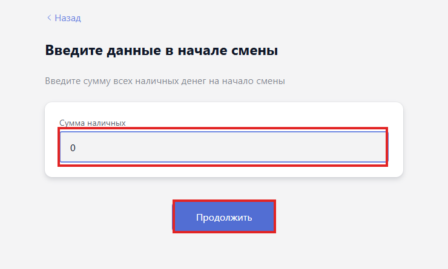
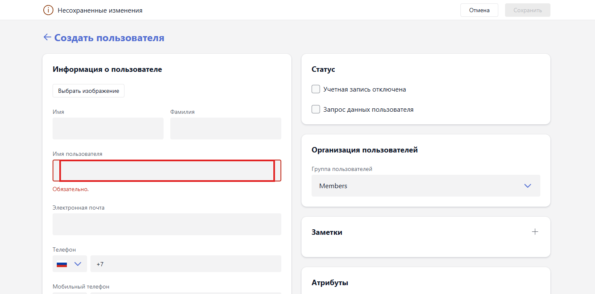
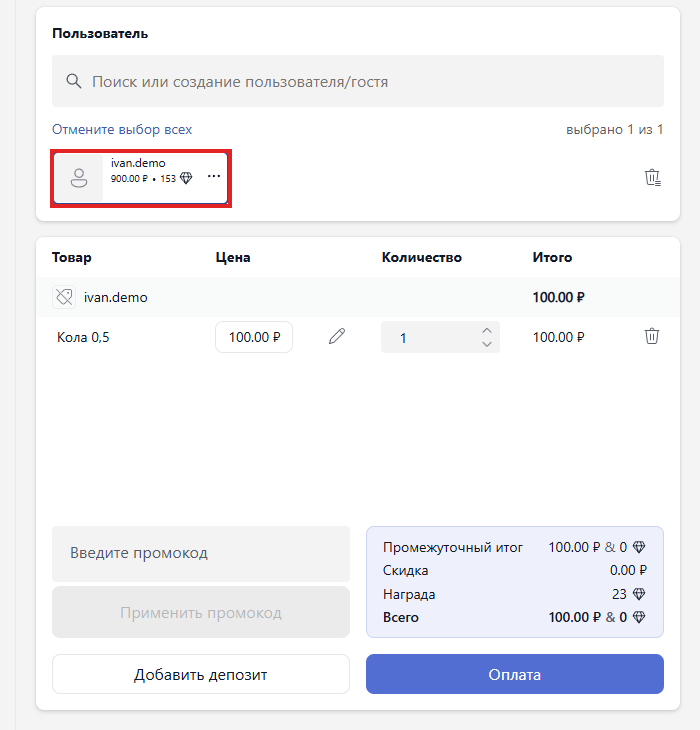
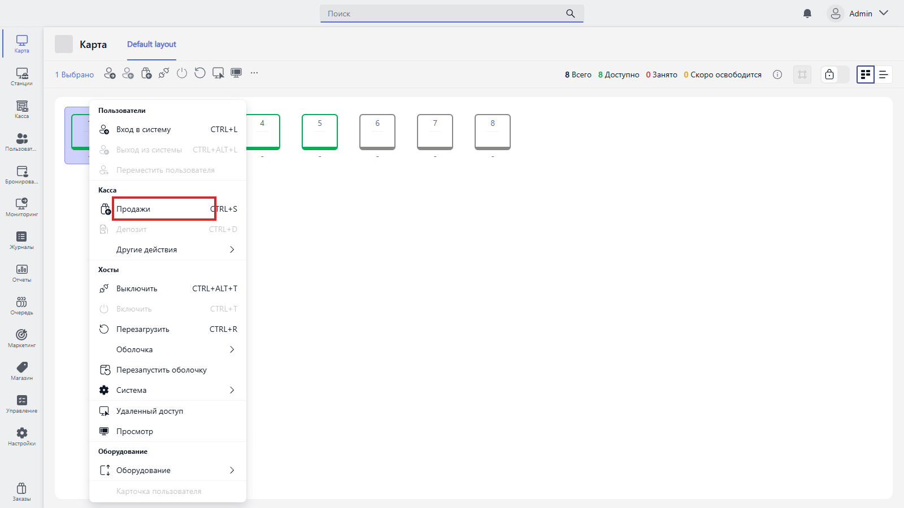
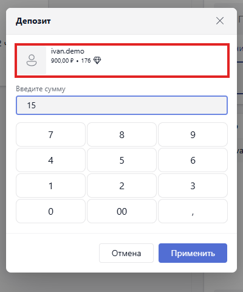
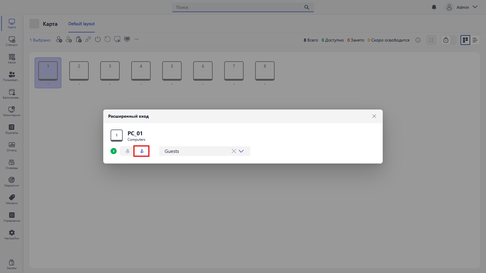
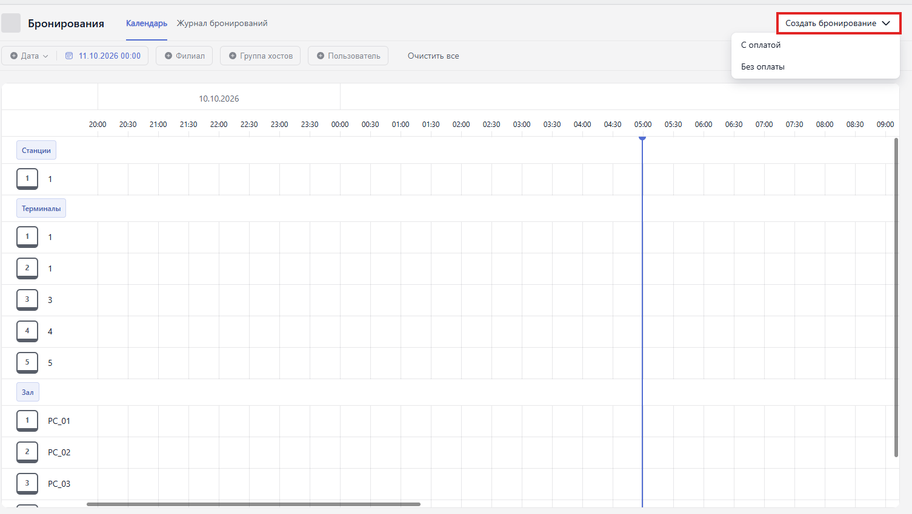
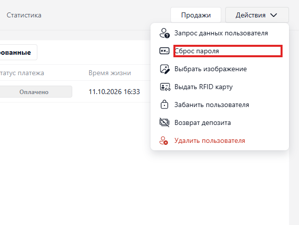
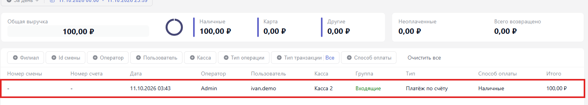
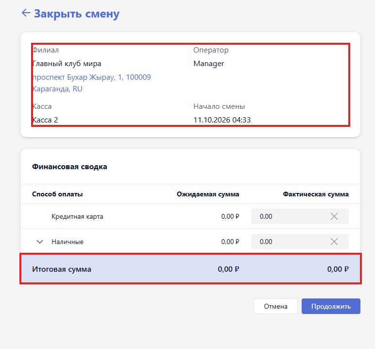

<html>

  

  

    

      <svg xmlns="http://www.w3.org/2000/svg" width="24" height="24" viewBox="0 0 24 24" fill="none" stroke="currentColor" stroke-width="2" stroke-linecap="round" stroke-linejoin="round"><rect x="8" y="2" width="8" height="4" rx="1" ry="1"/><path d="M16 4h2a2 2 0 0 1 2 2v14a2 2 0 0 1-2 2H6a2 2 0 0 1-2-2V6a2 2 0 0 1 2-2h2"/><path d="M12 11h4"/><path d="M12 16h4"/><path d="M8 11h.01"/><path d="M8 16h.01"/></svg>
      В этом блоке вы узнаете
    

    <h2 class="gx-title">Как провести смену за стойкой: от открытия кассы до закрытия смены</h2>
    

      15 минут
      /
      Низкая сложность
    

  

</html>

Это шпаргалка для администратора за стойкой: всё, что приходится делать за смену, -- по порядку, от открытия кассы до её закрытия. Открыть смену, зарегистрировать гостя, продать пакет или товар, пополнить депозит, посадить гостя за пк, забронировать место, закрыть зависшую игру, сверить деньги и закрыть смену.

Здесь только основные действия оператора. Как всё это настраивает администратор, описано в остальных инструкциях раздела -- ссылки есть в каждом шаге.

## Шаг 1. Откройте смену

Кассовые операции привязаны к кассе клуба. Если у оператора обязательные смены, открыть смену нужно до начала продаж.

1. Войдите в Gizmo Manager -- адрес клуба выдаёт администратор.
2. На странице **Выбор кассы** выберите кассу в списке и нажмите **Продолжить**.

{width=740px height=595px}

3. Если оператору назначены обязательные смены, откроется экран **Введите данные в начале смены**. Введите в поле **Сумма наличных** сумму, которая лежит в денежном ящике, и нажмите **Продолжить**.

{width=740px height=445px}

4. Смена открыта -- откроется карта клуба. Проверить смену можно в **Касса -> Действия -> Управление сменами**, на странице **Активные смены**.

> [!TIP]
>
> Обязательна ли смена для оператора, задаёт администратор: **Настройки -> Операторы и настройки прав доступа -> Операторы**, карточка оператора, блок **Смена** -- **Отключено**, **Необязательно** или **Обязательно**. Подробнее -- в инструкции [«Как управлять сменами в менеджере»](./shifts.md).

## Шаг 2. Зарегистрируйте гостя

1. Откройте раздел **Пользователи** и нажмите **Создать пользователя**.
2. В блоке **Информация о пользователе** заполните **Имя**, **Фамилию** и **Имя пользователя** -- это логин, поле обязательное. При необходимости укажите электронную почту и телефон.
3. **Группу пользователей** оставьте **Members** -- это обычные зарегистрированные клиенты.
4. Нажмите **Сохранить** -- пользователь появится в общем списке.

{width=1415px height=700px}

> [!NOTE]
>
> Учётную запись **оператора** для входа в Gizmo Manager создаёт только администратор: **Настройки -> Операторы и настройки прав доступа -> Операторы**, кнопка **Создать оператора**. Данные от клиентского сайта для входа не подходят. Почту и телефон оператора заполняйте реальными -- они нужны для восстановления доступа.

Подробнее об аккаунтах гостей -- в инструкции [«Аккаунты клиентов»](./../staff/user-accounts-guide.md).

## Шаг 3. Продайте пакет времени или товар

1. Откройте **Касса -> Продажи**.
2. В поле **Поиск или создание пользователя/гостя** начните вводить логин или номер телефона и выберите пользователя из списка. Над корзиной появится счётчик «выбрано 1 из 1».
3. Нажмите на нужный пакет времени или товар в каталоге слева -- позиция добавится в корзину.

{width=700px height=730px}

4. Нажмите **Оплата**.
5. Выберите тип оплаты: **Разовый платеж** или **Сплит** -- деление на несколько платежей.
6. Выберите способ: **Наличные**, **Кредитная карта**, **Депозит** или **Оплатить позже**. После выбора способа заполнится полученная сумма.
7. Проверьте **Итог** и нажмите **Оплатить**. Появится подтверждение «Платеж выполнен успешно».

{width=1000px height=725px}

> [!WARNING]
>
> - Продажа привязывается к выбранному пользователю. Если в поиске выбрано несколько, покупка уйдёт каждому -- перед оплатой проверьте счётчик у корзины.
> - **Оплатить позже** не принимает деньги: сумма попадает в отложенные оплаты пользователя. Сообщение «Платеж выполнен успешно» подтверждает запись операции, а не получение денег.
> - При **Наличных** сначала пересчитайте полученные деньги и сдачу, при **Кредитной карте** проверьте результат платежа на терминале. При **Депозите** списываются ранее внесённые гостем средства.

**Продажа на конкретную станцию**

1. В разделе **Карта** нажмите на нужную станцию.
2. Откройте меню правой кнопкой мыши и выберите **Касса -> Продажи** (CTRL+S).
3. Откроется та же корзина, но уже привязанная к этой станции. Если на станции никого нет, для продажи создастся гость. Добавьте пакет или товар и оплатите, как описано выше.

{width=1600px height=900px}

Гость сядет за станцию сам после продажи депозита или пакета времени, если администратор включил настройку **Автоматический вход гостей**. Если станция серая (выключена), сначала включите её: **Хосты -> Включить**.

## Шаг 4. Пополните депозит

Гости с почасовой оплатой тратят именно депозит.

1. Откройте **Касса -> Продажи** и выберите пользователя.
2. Нажмите **Добавить депозит** рядом с кнопкой **Оплата**.
3. Введите сумму на экранной клавиатуре и нажмите **Применить**.

{width=400px height=480px}

4. В корзине появится строка **Депозит**. Нажмите **Оплата**, примите деньги -- например, **Наличные** -- и нажмите **Оплатить**.

> [!WARNING]
>
> Депозит зачисляется только после оплаты: пока не нажата кнопка **Оплатить**, деньги на баланс гостя не попадают.

## Шаг 5. Посадите гостя за пк

1. В разделе **Карта** нажмите на станцию и откройте меню правой кнопкой мыши.
2. Выберите **Пользователи -> Вход в систему** (CTRL+L).
3. В окне **Расширенный вход** переключитесь на гостей: нажмите вторую кнопку-переключатель рядом с номером станции и выберите группу **Guests** в выпадающем списке.

{width=1600px height=900px}

4. Введите имя гостя в строку поиска, выберите его и нажмите **Войти в систему**.

> [!NOTE]
>
> Посадить гостя можно только на свободную -- зелёную -- станцию. Серая станция выключена: сначала включите её через **Хосты -> Включить**.

## Шаг 6. Забронируйте место

1. Откройте раздел **Бронирования** -- по умолчанию откроется **Календарь** с сеткой станций по дням и времени.
2. Нажмите **Создать бронирование** и выберите вариант: **С оплатой** или **Без оплаты**.

{width=1505px height=850px}

3. Укажите **Дату и время начала** и **Длительность**. Переключателем выберите владельца брони: гостя из базы или человека без учётной записи -- для него в поле **Владелец** выберите группу, например **Guests**. При необходимости добавьте телефон и примечания.
4. В блоке **Доступные хосты** отметьте один или несколько компьютеров -- список показывает только свободные на выбранное время.
5. Проверьте детали и нажмите **Продолжить**.
6. Проверьте сводку брони и нажмите **Сохранить**. Бронь появится в календаре и в **Журнале бронирований** со статусом «Ожидание».

> [!NOTE]
>
> Бронь **С оплатой** потребует оплату при создании. Если время уже занято, станции не будет в списке доступных -- выберите другой компьютер или время. Подробнее -- в инструкции [«Как создать бронирование»](./../booking/create-booking.md).

## Шаг 7. Помогите гостю с аккаунтом

Всё о госте -- в его карточке: откройте раздел **Пользователи** и дважды нажмите на строку с гостем.

- **За каким пк сидел гость** -- вкладка **Сеансы**: имя станции, время начала и окончания, продолжительность каждого сеанса. Вкладки **Пакеты** и **Депозиты** показывают купленное время и историю операций по депозиту -- пополнения и списания.
- **Сколько гость потратил** -- вкладка **Статистика**: потрачено денег (пакеты, сеансы, товары), заработанные и погашенные баллы, время в системе и количество входов.
- **Гость забыл пароль** -- нажмите **Действия** в правом верхнем углу карточки, выберите **Сброс пароля** и подтвердите действие в диалоге. Пароль обнуляется сразу: гость входит только по логину и сам задаёт новый пароль после входа.

{width=600px height=452px}

> [!WARNING]
>
> Сбрасывайте пароль только по просьбе владельца учётной записи и после проверки его личности.

## Шаг 8. Закройте зависшую игру

1. Откройте раздел **Управление**, вкладку **Процессы**.
2. Слева нажмите **Развернуть все** и поставьте флажок напротив нужной станции.
3. Найдите зависший процесс -- вручную или через фильтр **Название процесса** -- и нажмите значок **«…»** справа в строке.
4. Выберите **Завершить**. Пункты **Завершить на выбранном** и **Завершить на всех** закрывают процесс сразу на нескольких станциях.

Результат команды виден в **Журналах** внизу вкладки.

> [!WARNING]
>
> Не завершайте системные процессы Windows -- System, Registry, csrss, smss, wininit, svchost, services: это может привести к сбою, перезагрузке или «синему экрану». Завершение игры может уничтожить несохранённый прогресс. Если проблема на одной станции, не выбирайте **Завершить на всех**.

Подробнее -- в инструкции [«Как удалённо управлять пк: файлы, процессы, задачи»](./remote-management-guide.md).

## Шаг 9. Сверьте продажи и деньги

- **Касса -> Журнал платежей** -- сверху сводка **За день**: общая выручка, наличные, карта, другие, неоплаченные и **Всего возвращено**. Ниже -- список операций: дата, оператор, пользователь, касса, тип операции, способ оплаты и сумма. Фильтрами **Филиал**, **Id смены**, **Оператор**, **Пользователь**, **Касса**, **Тип операции** и **Способ оплаты** можно сузить список. По умолчанию показан текущий день, с 00:00 до 23:59 -- для вчерашней смены поменяйте даты.

{width=1495px height=270px}

- **Отложенные оплаты** -- суммы, проведённые способом **Оплатить позже**, фиксируются в блоке отложенных оплат пользователя. Счета записываются отдельно: **Отчеты -> Все отчеты -> Журнал счетов**.
- **Касса -> Депозиты** -- каждая операция по депозитам: тип (пополнение или списание), способ оплаты, филиал, пользователь, баланс после операции, оператор, дата и сумма. Колонка **Баланс** показывает остаток после конкретной операции, а не текущий -- текущий остаток виден в списке **Пользователи**, в колонке **Баланс**.

> [!NOTE]
>
> Закрытие экрана оплаты крестиком отменяет оформление -- платёж ещё не проведён. Вопросы по уже проведённым платежам решает администратор.

## Шаг 10. Закройте смену

1. Пересчитайте наличные в ящике и сверьте операции своей смены в **Отчеты -> Журнал смен**: там видны смена, стартовые наличные и ожидаемая сумма по способам оплаты. Учтите, что смена длится от открытия до закрытия и может не совпадать с календарным днём.
2. При необходимости снимите промежуточный итог: **Касса -> Действия -> X-отчет (касса)**. Это отчёт по наличным без закрытия смены -- снимать его можно сколько угодно раз.
3. Откройте **Касса -> Действия -> Управление сменами**. На странице **Активные смены** найдите свою смену и нажмите **Закончить**.
4. В диалоге **Закрыть смену** сверьте ожидаемую и фактическую суммы по способам оплаты и нажмите **Продолжить**.

{width=772px height=718px}

> [!WARNING]
>
> Если суммы расходятся, сначала выясните причину. Подставлять ожидаемую сумму вместо фактической нельзя.

> [!TIP]
>
> Если вы вышли из Gizmo Manager, не закрыв смену, при следующем входе появится экран **Чем бы вы хотели заняться?** с выбором: **Продолжить открытую смену** или **Закрыть открытую смену**.

## Результат

- Оператор открывает смену на своей кассе и закрывает её со сверкой наличных.
- Регистрирует гостей, продаёт пакеты и товары, пополняет депозит и сажает гостей за свободные станции.
- Оформляет брони, помогает гостю с паролем и историей сеансов, закрывает зависшие игры.
- Все операции видны в журнале платежей, журнале депозитов и журнале смен.

Если возникли вопросы по работе, обратитесь к администратору клуба или в [поддержку Gizmo](./../../about/support.md).
