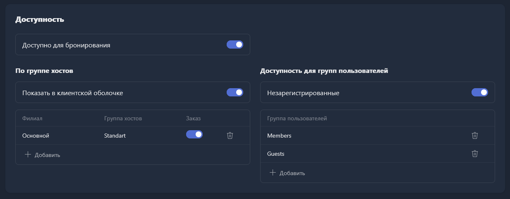
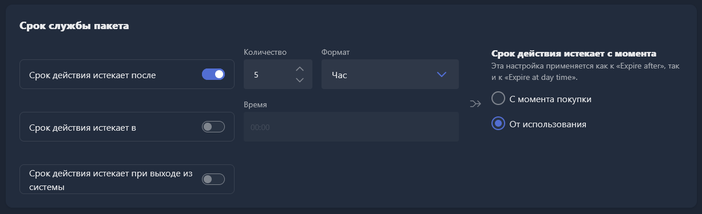

<html>

  

  

    

      <svg xmlns="http://www.w3.org/2000/svg" width="24" height="24" viewBox="0 0 24 24" fill="none" stroke="currentColor" stroke-width="2" stroke-linecap="round" stroke-linejoin="round"><path d="M21 8 12 3 3 8v8l9 5 9-5z"/><path d="M3 8l9 5 9-5"/><line x1="12" y1="13" x2="12" y2="21"/></svg>
      В этом блоке вы узнаете
    

    <h2 class="gx-title">Как создать пакет времени</h2>
    

      15–20 минут
      /
      Средняя сложность
    

  

</html>

Пакеты времени приносят клубу больше, чем обычная почасовая оплата -- гость видит выгодное предложение и покупает именно его, даже если изначально планировал сидеть меньше. Полей в карточке пакета много, но ниже -- только то, что действительно нужно для старта.

## Шаг 1. Заполните детали пакета

1. Перейдите в <cmd text="Настройки"/> -> <cmd text="Финансовый"/> -> <cmd text="Пакеты"/> -> <cmd text="Создать пакет времени"/>.
2. В блоке **Детали пакета** укажите:

   - **Имя** -- выберите единый формат для всех пакетов, например «\[зона\] + длительность»: Standart 3 часа, VIP 5 часов.
   - **Товарная группа** -- категория, к которой относится пакет (настраивается в <cmd text="Магазин"/> -> <cmd text="Группы товаров"/>).
   - **Количество минут**, которое даёт пакет, и при необходимости -- описание.

## Шаг 2. Настройте доступность пакета

В блоке **Доступность**:

- **Доступно для бронирования** -- можно ли оплатить этим пакетом бронирование пк.
- **Показать в клиентской оболочке** -- появится ли пакет в магазине на клиентских пк.
- В таблице ниже добавьте только те филиалы и группы станций, где пакет реально должен продаваться -- например, пакет Standart 3 часа не стоит привязывать к зоне VIP, иначе гости будут покупать его дешевле и использовать в более дорогой зоне. Чтобы пакет можно было купить прямо в клиентской оболочке, включите переключатель **«Заказ»** рядом с каждой добавленной группой.
- **Незарегистрированные** -- включите, если пакетом смогут пользоваться и разовые (гостевые) учётные записи.
- В таблице **Группа пользователей** отметьте, кому доступен пакет. Обычно проще дать доступ всем группам, если нет причин ограничивать.

> [!NOTE]
> 
> Группа пользователей -- это категория клиентов со своими ценами, скидками и доступами. Например, вы можете создать «Зарегистрированные» -- обычные клиенты, «Гости» -- разовые аккаунты, «VIP» -- премиум со скидкой 10%, «Staff» -- сотрудники со скидкой 100% и без ограничений системы.

{width=1233px height=483px}

## Шаг 3. Включите пакет в нужных филиалах

Блок **Доступность в филиалах** -- похожая настройка, но на уровне целого филиала: она определяет, в каких клубах сети пакет вообще можно использовать. По умолчанию выключена -- включите для нужных филиалов.

## Шаг 4. При необходимости ограничьте пакет по датам и времени

В блоке **Диапазон использования и расписание продаж** два поля ограничивают пакет по датам или времени:

- **Диапазон дат** -- конкретные даты, когда пакет можно купить или использовать. Пригодится для акционных пакетов с ограниченным сроком.
- **Диапазон времени** -- дни недели и часы, когда пакет доступен для покупки или использования. Если выключено -- ограничений нет.

## Шаг 5. Задайте срок службы пакета

В блоке **Срок службы пакета** задаются условия, при которых пакет сгорает. Это мотивирует гостя доиграть пакет, а не растягивать его на потом.

1. Выберите момент начала отсчёта:
   - **С момента покупки** -- отсчёт стартует сразу после оплаты.
   - **От использования** -- отсчёт стартует, когда гость начинает пакет использовать.
2. Выберите один из трёх типов истечения:
   - **Срок действия истекает после** -- пакет сгорает через заданный промежуток.
   - **Срок действия истекает в** -- пакет сгорает в ближайшее наступление указанного времени суток.
   - **Срок действия истекает при выходе из системы** -- пакет сгорает сразу после завершения сеанса гостя. Будьте аккуратны: случайный выход из аккаунта тоже удалит пакет.

Самый частый вариант -- пакет сгорает через своё же количество часов после начала использования. Например, для пакета на 5 часов: **Срок действия истекает после** -- 5, формат -- часы, отсчёт -- «От использования».

{width=1227px height=375px}

## Шаг 6. Укажите цену пакета

В блоке **Ценообразование** укажите цену пакета в деньгах и, если нужно, в баллах. Если оплата возможна и деньгами, и баллами на выбор -- переключите «И» на «ИЛИ».

> [!IMPORTANT]
> 
> Баллы -- часть бонусной системы: вы начисляете клиентам баллы за покупки, а они тратят их на товары и пакеты по установленной вами цене.

## Шаг 7. Настройте начисление бонусных баллов

Если у вас уже есть бонусная система, не забудьте настроить начисление баллов в блоке «Награда» для каждого нового пакета -- иначе часть пакетов будет копить баллы, а часть нет, и гости это быстро заметят. Подробнее -- в инструкции [«Бонусные баллы для клиентов»](./../../loyalty/loyalty-program.md).

## Результат

- Пакет продаётся только в выбранных филиалах, группах станций и группах пользователей, а при включённых настройках -- и в магазине клиентской оболочки.
- Гость оплачивает пакет деньгами и/или баллами, а пакет сгорает по заданным условиям срока службы.
- Если в клубе работает бонусная система, за покупку пакета начисляются баллы -- так же, как за остальные пакеты.
