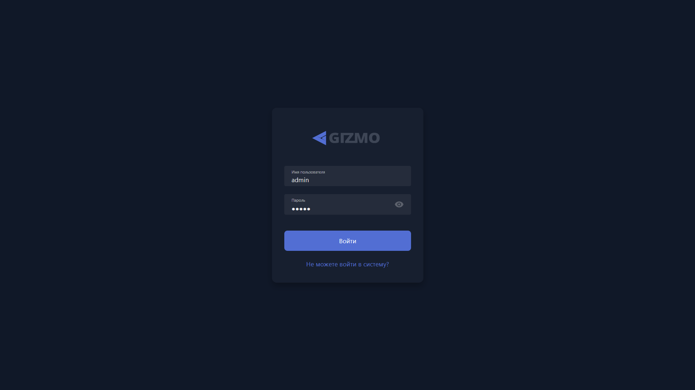
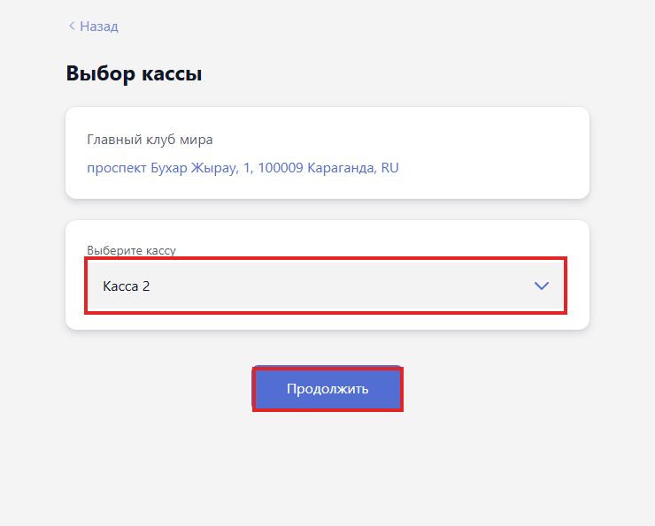
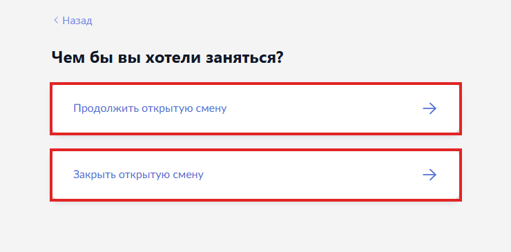

{width=1919px height=1079px}

Главный экран авторизации. Здесь нужно указать **Имя пользователя** и **Пароль** оператора, чтобы войти в аккаунт. Учётные данные с клиентского сайта не подойдут -- доступ дают только учётные данные, выданные оператору.

> [!TIP]
> 
> Не рекомендуем использовать простые пароли или пароли по умолчанию. При создании [учётной записи оператора](./../../configure/operators-and-permissions/operators/_index.md) задавайте надёжный пароль для себя и своих сотрудников.

Учётную запись оператора создаёт только администратор: **Настройки -> Операторы и настройки прав доступа -> Операторы**, кнопка <cmd text="Создать оператора"/>. Почту и телефон оператора стоит заполнять реальными -- они нужны для восстановления доступа.

## Выбор кассы

После входа открывается экран **Выбор кассы**. В верхнем блоке указаны название и адрес филиала, ниже -- поле **Выберите кассу** со списком касс. Выберите кассу, на которой будете работать, и нажмите <cmd text="Продолжить"/>. Все продажи оператора в этом сеансе будут относиться к выбранной кассе.

{width=740px height=595px}

## Данные в начале смены

Если в карточке оператора смена отмечена как **Обязательно**, после выбора кассы откроется экран **Введите данные в начале смены**. В поле **Сумма наличных** укажите, сколько наличных лежит в денежном ящике на начало смены, и нажмите <cmd text="Продолжить"/> -- смена откроется, и вы попадёте на карту клуба.

{width=740px height=445px}

Режим смены для оператора задаёт администратор в [карточке оператора](./../../configure/operators-and-permissions/operators/operators-card.md), блок **Смена**: **Отключено**, **Необязательно** или **Обязательно**.

## Вход с открытой сменой

Если оператор вышел из Gizmo Manager, не закрыв смену, при следующем входе появится экран **Чем бы вы хотели заняться?** с двумя вариантами:

- **Продолжить открытую смену** -- вернуться к работе в той же смене;
- **Закрыть открытую смену** -- перейти к закрытию смены со сверкой сумм.

{width=740px height=365px}

Как открывать и закрывать смену -- в инструкции [«Как управлять сменами в менеджере»](./../../tutorials/operations/shifts.md).
