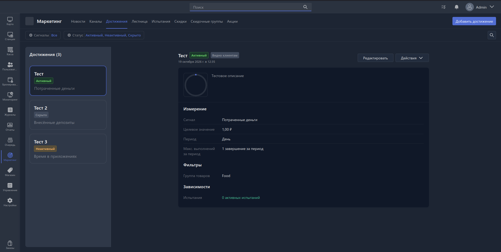

Достижение - это базовый элемент для Программы лояльности пользователей.

На данной вкладке отображаются все ранее настроенные достижения, учитываемы в вашем заведении. Также в данном разделе доступно создание, редактирование и удаление достижений.

{width=1919px height=968px}

## Создание достижения

Для создания достижения необходимо нажать на кнопку «Добавить достижение», находящуюся в верхнем правом углу.

После нажатия откроется [Карточка достижения](./achivement-card.md).

## Навигация по достижениям

Все созданные достижения отображаются в левой колонке в виде бейджей достижений.

На бейдже достижения присутствует следующая информация: Название, Статус (Активный, Неактивный, Скрытый), Название сигнала. Подробнее о значениях данных параметров можно узнать в разделе [Карточка достижения](./achivement-card.md).

Для фильтрации достижений в верхней части страницы доступны следующие фильтры:

- Сигналы
- Статусы

Для поиска достижений по названию можно использовать кнопку Поиска в верхней правой части страницы.

При выборе бейджа в правой части экрана открывается превью карточки достижения, а также дополнительные действия (Редактировать, Удалить, Включить/Отключить).

[Карточка достижения](./achivement-card.md) может быть открыта либо по двойному клику на бейж, либо через кнопку «Редактировать».
