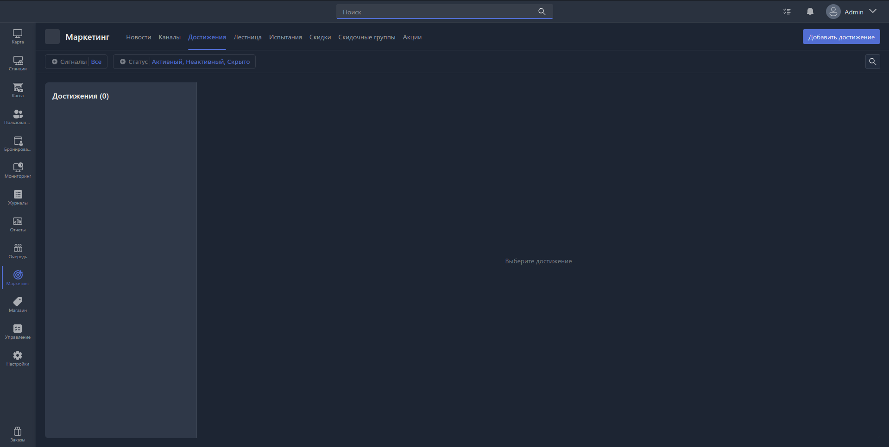

Достижение - это базовый элемент для Программы лояльности пользователей.

Достижения отображают самый подробный прогресс пользователя.

В данном разделе отображают все ранее настроенные достижения, учитываемы в вашем заведении. Также в данном разделе доступно создание, редактирование и удаление достижений.

{width=1919px height=966px}

## Создание достижения

Для создания достижения необходимо нажать на кнопку «Добавить достижение», находящуюся в верхнем правом углу.

После нажатия откроется Карточка создания достижения.
