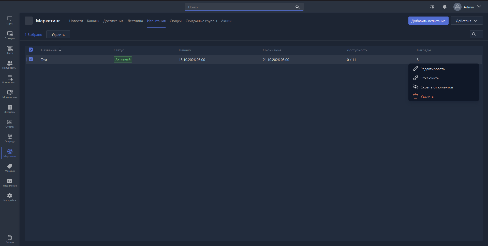

{width=1919px height=968px}

На данной вкладке оператору доступна таблица с ранее созданными испытаниями. Также на данной вкладке оператор может создавать, удалять и редактировать испытания.

Испытания -- это набор достижений, заработав которые, пользователю полагается награда.

В таблице отображается следующий набор параметров испытаний:

- **Название**. Название испытания
- **Статус** (активный/неактивный, скрытое от клиента)
- **Начало**. Дата начала испытания
- **Окончание**. Дата окончания испытания
- **Доступность.** Количество доступных испытаний для выполнения.

## Массовое удаление

На вкладке реализована возможность массового удаления испытаний. Для массового удаления испытаний необходимо выделить необходимые или все испытания на странице с использованием галочек. Для того, чтобы выбрать все испытания нажмите галочку в шапке таблицы.

## Фильтры и поиск

На вкладке доступен поиск и фильтрация по следующим параметрам:

- Статус

Все заданные условия фильтрации снимаются ссылкой <cmd text="Очистить все" />.

## Создание испытания

Для создания испытания необходимо нажать кнопку «Создать испытание» в верхнем правом углу экрана. По результату нажатия на кнопку откроется [карточка испытания.](./challange-card.md)

## Прочие действия

Для каждого испытания в подменю «…» доступны следующие действия:

- Редактировать
- Отключить
- Скрыть от клиентов
- Удалить

### Редактирование испытания

Для редактирования испытания необходимо дважды нажать на строку с испытанием, либо вызвать дополнительное меню в строке испытания «…» и нажать кнопку «Редактировать». По результату нажатия на кнопку откроется [карточка испытания.](./challange-card.md)

### Изменение статуса испытания

Для изменения статуса испытания необходимо дважды нажать на строку с испытанием, либо вызвать дополнительное меню в строке испытания «…» и нажать кнопку «Включить»/«Отключить», «Скрыть от клиентов»/«Показать клиентам». Дополнительно, данные действия доступны в [карточке испытания](./challange-card.md).
