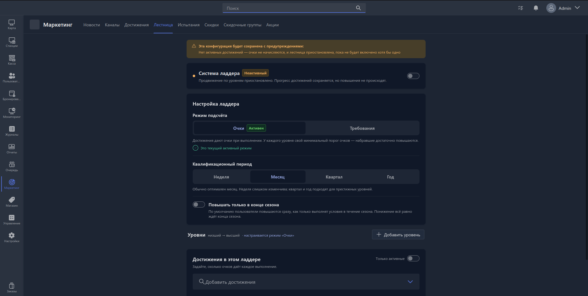

{width=1919px height=967px}

## Общие параметры настройки

К общим параметрам настройки Уровней привелегий относятся:

- Статус системы  (активна/неактивна). В случае, если неактивна, расчет Уровня привелегий пользователей не производится.
- Режим подсчета (очки/требования). Подробно с режимами расчета привелегий можно ознакомиться на главной странице[ Уровни привелегий](./_index.md). Посде выбора режима подсчета, и, в случае, если данный режим подсчета не является текущим, оператору становится доступна кнопка «Активировать режим».
- Квалификационный период. Это период за который происходит учет достижений польнователя. Доступные значения:
  - Неделя
  - Месяц
  - Квартал
  - Год
- Повышать только в конце сезона (вкл/выкл). По умолчанию данный параметр выключен и повышение уровня привелегий пользователя происходит сразу. Если включить данный параметр - повышение уровня будет в конце сезона, то есть реализуется система, в которой преимущества в текущем периоде, зависят от достижений предыдущего периода.

  > [!IMPORTANT]
  >
  > **Пример 1.**
  >
  > Квалификационный прериод - год.\
  > Повышать уровень в конце сезона - **выкл**.
  >
  > В 2025 году пользователь получил достижение. В 2026 году это достижение пользователя не будет учтено в расчете уровня привелегий.
  >
  > \
  > **Пример 2.**
  >
  > Квалификационный прериод - год.\
  > Повышать уровень в конце сезона - **вкл**.
  >
  > В 2025 году пользователь получил достижение. В 2025 году это достижение пользователя не будет учтено в расчете уровня привелегий, но будет учтено в расчете уровня привелегий пользователя на 2026 год.

## Уровни

Для создания уровня нажмите кнопку «Добавить уровень». Вам откроется [карточка уровня](./level-card/_index.md).

Ранее созданные уровни отображаются на странице в виде бейджей, на которых доступны следующая информация и действия:

- Номер уровня
- Название уровня
- Группа пользователей уровня (Группа пользователей, в которую попадают пользователи при достижении данного уровня)
- Кнопка редактирования уровня (Доступна через подменю в правой части бейджа «…»)
- Кнопка удаления уровня (Доступна через подменю в правой части бейджа «…»)

В зависимости от выбранного режима подсчета,  в каждом уровне дополнительно отображаются следующие элементы:

#### Режим посчета - по заработанным очкам за достижения

- Порог очков. Значение очков, необходимое пользователю для получения данного уровня привелегий

#### Режим посчета - по заработанным достижениям

- Требования. Список достижений, необходимых пользователю для получения данного уровня привелегий
- Кнопка перемежения уровня («::» расположена слева от номера уровня)

## Достижения

Данной блок отображается на экране только для Режима посчета - по заработанным очкам за достижения.

В данном блоке доступны:

- Элементы фильтрации отображаемых достижений (только активные)
- Поисковая строка для поиска и добавления достижений в список
- Список добавленных достижений, в котором доступно:
  - Название достижения
  - Сигнал достижения
  - Период расчета достижения
  - Статус достижения (скрыто, неактивно)
  - Количество очков, присваивающихся за данное достижение (редактируемое)
  - Кнопка перехода в карточку достижения  (Доступна через подменю в правой части строки «…»)
  - Кнопка удаления достижения из списка  (Доступна через подменю в правой части строки «…»)
