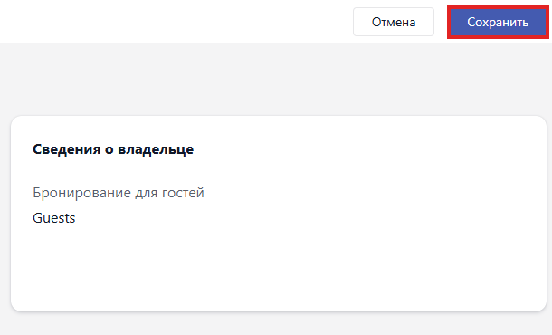

Карточка содержит все условия одной брони: когда и насколько бронируется место, кто владелец брони и какие станции в неё входят.

Карточка открывается кнопкой <cmd text="Создать бронирование"/> в [календаре](./calendar.md) -- после выбора варианта **С оплатой** или **Без оплаты**. Экран разделён на две колонки: слева условия брони, справа выбор станций.

## Детали бронирования

Первый блок левой колонки.

-  **Дата и время начала** -- момент, с которого место занято. Рядом с полем стоит значок календаря.

-  **Длительность** -- на сколько бронируется место. Выбирается из списка со значениями от `00:30` и дальше с шагом в полчаса.

## Информация о владельце

Второй блок левой колонки.

-  **Владелец** -- на кого оформляется бронь. Слева от поля стоят два переключателя: бронь на заведённого в базе гостя либо на человека без учётной записи.

-  **Дополнительный телефон** -- запасной номер для связи. Слева от поля выбирается код страны.

## Примечания

Третий блок левой колонки. Пока заметок нет, в блоке стоит надпись «Нет примечаний». Значок карандаша открывает окно для ввода текста.

## Доступные хосты

Правая колонка. Содержит перечень станций, свободных на заданное время, -- в бронь можно взять как одну станцию, так и несколько сразу.

Список появляется не сразу: пока не заполнены дата, длительность и владелец, вместо него стоит подсказка «Необходимые параметры бронирования -- Выберите дату, продолжительность и владельца для просмотра доступных хостов».

## Сохранение брони

Когда условия заполнены и станции отмечены, нажмите <cmd text="Продолжить"/> в правом верхнем углу. Откроется сводка брони с блоком **Сведения о владельце** -- проверьте её и нажмите <cmd text="Сохранить"/>. Кнопка <cmd text="Отмена"/> закрывает карточку без сохранения.

{width=610px height=370px}

Бронь **С оплатой** потребует оплату при создании. Оформленная бронь попадает в [журнал бронирований](./reservation-log.md) со статусом «Ожидание» и в сетку [календаря](./calendar.md).
