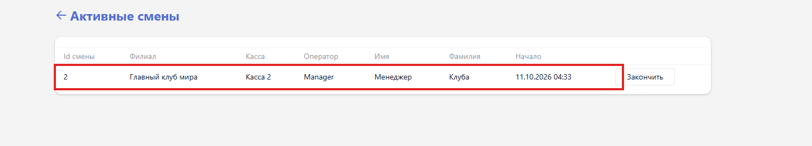

Раздел предназначен для продажи времени и товаров, приёма оплаты, ведения депозитов пользователей и снятия отчётов по кассе. Разделён на пять вкладок, первой открывается «Продажи».

Раздел открывается кнопкой <cmd text="Касса"/> в левом меню.

## Вкладки

-  **Продажи** -- экран продажи: корзина, ассортимент, расчёт. Разобран в статье [«Продажи»](./prodazhi.md).

-  **Журнал платежей** -- принятые платежи. Сверху -- сводка **За день**: **Общая выручка**, **Наличные**, **Карта**, **Другие**, **Неоплаченные** и **Всего возвращено**. Ниже -- список операций с колонками **Номер смены**, **Номер счета**, **Дата**, **Оператор**, **Пользователь**, **Касса**, **Группа**, **Тип**, **Способ оплаты** и **Итого**. Список сужается фильтрами **Филиал**, **Id смены**, **Оператор**, **Пользователь**, **Касса**, **Тип операции**, **Тип транзакции** и **Способ оплаты**. По умолчанию показан текущий день -- с 00:00 до 23:59.

-  [**Заказы**](./zakazy/_index.md) -- журнал заказов, оформленных пользователями.

-  **Электронные платежи** -- безналичные операции.

-  **Депозиты** -- операции по депозитам пользователей: **Тип** (пополнение или списание), **Способ оплаты**, **Филиал**, **Пользователь**, **Баланс**, **Оператор**, **Дата** и **Сумма**. Колонка **Баланс** показывает остаток депозита после конкретной операции, а не текущий -- текущий остаток виден в списке [пользователей](./../users/users/_index.md), в колонке **Баланс**.

## Смена и отчёты по кассе

Работа кассира привязана к кассе: при входе в Gizmo Manager оператор выбирает кассу, в которой будет работать, и все его продажи относятся именно к ней. Экраны выбора кассы и открытия смены описаны в статье [«Экран входа в систему»](./../login-screen.md).

С экрана продаж доступны служебные действия:

-  <cmd text="Открыть денежный ящик"/> -- открывает ящик без проведения продажи.

-  <cmd text="X-отчет (касса)"/> -- промежуточный отчёт по наличным без закрытия смены.

-  <cmd text="X-отчет (эквайринг)"/> -- промежуточный отчёт по безналичным платежам.

X-отчёт не закрывает смену и может сниматься неограниченное число раз. Итоги закрытых смен доступны в разделе [«Отчеты»](./../otchety/_index.md), вкладка «Журнал Z».

## Управление сменами

Через **Действия -> Управление сменами** открывается страница **Активные смены** -- список открытых смен с колонками **Id смены**, **Филиал**, **Касса**, **Оператор**, **Имя**, **Фамилия** и **Начало**. Кнопка <cmd text="Закончить"/> в строке смены переходит к её закрытию.

{width=1495px height=270px}

На странице **Закрыть смену** указаны филиал, касса, оператор и время начала смены, а в блоке **Финансовая сводка** -- **Ожидаемая сумма** и поле **Фактическая сумма** для каждого способа оплаты и **Итоговая сумма**. Кнопка <cmd text="Продолжить"/> закрывает смену, <cmd text="Отмена"/> -- возвращает к списку.

{width=772px height=718px}

> [!WARNING]
>
> Если ожидаемая и фактическая суммы расходятся, сначала выясните причину. Подставлять ожидаемую сумму вместо фактической нельзя.

Порядок закрытия смены -- в инструкции [«Как управлять сменами в менеджере»](./../../../tutorials/operations/shifts.md).
