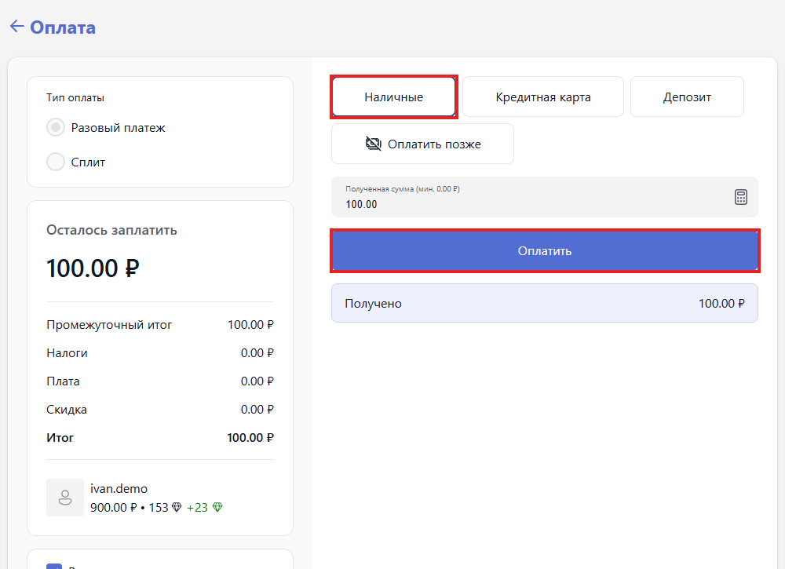

Вкладка предназначена для оформления продаж. Экран разделён на две части: слева ассортимент, разложенный по группам товаров, справа корзина текущей продажи. Над ними расположен переключатель режима продажи.

## Режим продажи

-  **Гости** -- продажа без учётной записи. Сумма проходит через кассу, но за пользователем не закрепляется.

-  **Авторизованные** -- продажа конкретному пользователю. Покупка попадает в его историю, может быть оплачена с депозита и учитывается при расчёте скидок.

Если пользователя нет в системе, его можно завести с этого же экрана -- кнопкой <cmd text="Создать пользователя"/>.

## Пользователь

Блок над корзиной. В поле **Поиск или создание пользователя/гостя** пользователя ищут по логину или номеру телефона. Выбранные пользователи показываются плашками с балансом и баллами, справа -- счётчик вида «выбрано 1 из 1». Ссылка **Отмените выбор всех** снимает выбор.

> [!WARNING]
>
> Продажа привязывается к выбранным пользователям. Если выбрано несколько, покупка уйдёт каждому -- перед оплатой проверьте счётчик.

## Корзина

-  **Товар** -- наименование позиции.

-  **Цена** -- цена за единицу.

-  **Количество** -- число единиц.

-  **Итого** -- сумма по строке.

Ассортимент слева разложен по вкладкам: **Все** содержит весь перечень, остальные соответствуют группам товаров, заведённым в разделе [«Магазин»](./../magazin/_index.md).

Под корзиной:

-  Поле **Введите промокод** и кнопка <cmd text="Применить промокод"/>.

-  Итоги: **Промежуточный итог**, **Скидка**, **Награда** (сколько баллов начислится за покупку) и **Всего**.

-  <cmd text="Добавить депозит"/> -- добавляет в корзину строку пополнения депозита на введённую сумму. Депозит зачисляется только после оплаты.

-  <cmd text="Оплата"/> -- переходит к экрану оплаты.

## Экран оплаты

{width=1000px height=725px}

-  **Тип оплаты** -- **Разовый платеж** или **Сплит** (деление суммы на несколько платежей).

-  **Осталось заплатить** и расчёт суммы: **Промежуточный итог**, **Налоги**, **Плата**, **Скидка**, **Итог**.

-  Способы оплаты -- **Наличные**, **Кредитная карта**, **Депозит**, **Оплатить позже** и дополнительные способы, заведённые в [«Способах оплаты»](./../../../configure/finance/paymet-methods/_index.md). После выбора способа заполняется поле **Полученная сумма**.

-  <cmd text="Оплатить"/> -- проводит платёж. После него появляется подтверждение «Платеж выполнен успешно».

> [!IMPORTANT]
>
> **Оплатить позже** не принимает деньги: сумма попадает в отложенные оплаты пользователя. Сообщение «Платеж выполнен успешно» подтверждает запись операции, а не получение денег. Закрытие экрана оплаты крестиком отменяет оформление -- платёж не проводится.

## Порядок продажи

1. Выберите режим: **Гости** или **Авторизованные**. Во втором случае укажите пользователя в поле **Поиск или создание пользователя/гостя**.

2. Наберите корзину, выбирая позиции в левой части экрана.

3. Проверьте состав и сумму корзины.

4. Нажмите <cmd text="Оплата"/>, выберите тип и способ оплаты и нажмите <cmd text="Оплатить"/>.

Проведённая продажа попадает на вкладку «Журнал платежей», а её сумма -- в сводку по смене в разделе [«Отчеты»](./../otchety/_index.md).
