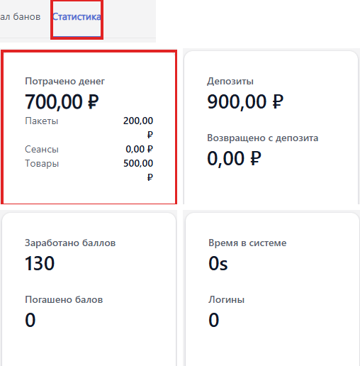

Карточка содержит всё об одном госте: его данные, группу, деньги, время, баллы и историю посещений.

Карточка открывается двойным нажатием на строку в [списке пользователей](./_index.md), а кнопка <cmd text="Создать пользователя"/> открывает её пустую форму. Изменения сохраняются кнопкой <cmd text="Сохранить"/> в правом верхнем углу, <cmd text="Отмена"/> -- отменяет их. Пока изменения не сохранены, вверху экрана стоит пометка «Несохраненные изменения».

{width=1415px height=700px}

## Информация о пользователе

Левая колонка.

-  <cmd text="Выбрать изображение"/> -- аватар пользователя.

-  **Имя** и **Фамилия**.

-  **Имя пользователя** -- логин, под которым гость входит в клиентскую оболочку. Обязательное поле.

-  **Электронная почта**.

-  **Телефон** и **Мобильный телефон** -- слева от номера выбирается код страны.

Какие ещё поля обязательны, задаёт группа пользователя -- блок **Необходимая информация о пользователе** в [карточке группы](./../user-groups/user-group-card.md).

## Статус

-  **Учетная запись отключена** -- пользователь не сможет войти.

-  **Запрос данных пользователя** -- при входе пользователя попросят заполнить недостающие данные.

## Организация пользователей

Поле **Группа пользователей** -- группа, правила которой действуют для пользователя: доступ к станциям, способы оплаты времени, скидка, кредит и баллы. Для обычных зарегистрированных клиентов подходит группа **Members**. Подробнее -- в статье [«Группы пользователей»](./../user-groups/_index.md).

## Заметки и атрибуты

-  **Заметки** -- служебные заметки оператора. Новая заметка добавляется значком **+**.

-  **Атрибуты** -- дополнительные поля, заведённые в [«Атрибутах»](./../../../../configure/server/attributes/_index.md).

## Вкладки существующего пользователя

У сохранённого пользователя в карточке появляются вкладки с историей:

-  **Сеансы** -- все сеансы гостя: имя станции, время начала и окончания, продолжительность. Имя станции в строке -- это пк, за которым сидел гость.

-  **Пакеты** -- купленные пакеты времени.

-  **Депозиты** -- история операций по депозиту: пополнения и списания.

-  **Журнал банов** -- история блокировок пользователя.

-  **Статистика** -- сводка по гостю:
   -  **Потрачено денег** -- всего и в разбивке на **Пакеты**, **Сеансы** и **Товары**;
   -  **Депозиты** и **Возвращено с депозита**;
   -  **Заработано баллов** и **Погашено баллов**;
   -  **Время в системе** и **Логины** -- количество входов.

{width=508px height=516px}

## Действия

В правом верхнем углу карточки -- кнопка <cmd text="Продажи"/>, которая открывает продажу на этого пользователя, и меню <cmd text="Действия"/>:

-  **Запрос данных пользователя** -- попросить гостя заполнить недостающие данные.

-  **Сброс пароля** -- обнуляет пароль после подтверждения в диалоге. Сброс действует сразу: гость входит только по логину и сам задаёт новый пароль после входа.

-  **Выбрать изображение** -- сменить аватар.

-  **Выдать RFID карту** -- привязать к пользователю RFID-карту.

-  **Забанить пользователя** -- закрыть гостю доступ к станциям.

-  **Возврат депозита** -- вернуть гостю средства с депозита.

-  **Удалить пользователя**.

{width=600px height=452px}

> [!WARNING]
>
> Сбрасывайте пароль только по просьбе владельца учётной записи и после проверки его личности.

Как создать аккаунт и пополнить депозит -- в инструкции [«Аккаунты клиентов»](./../../../../tutorials/staff/user-accounts-guide.md).
